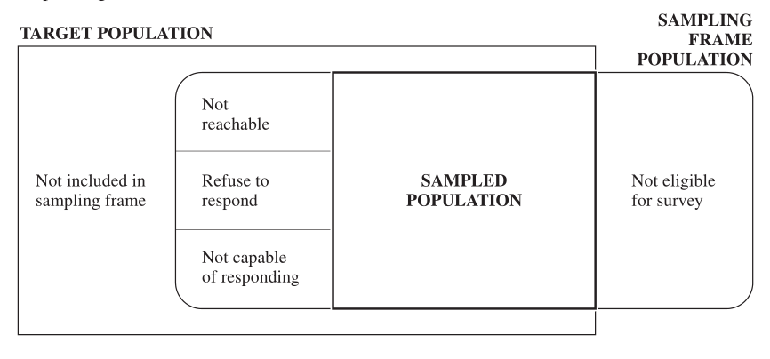
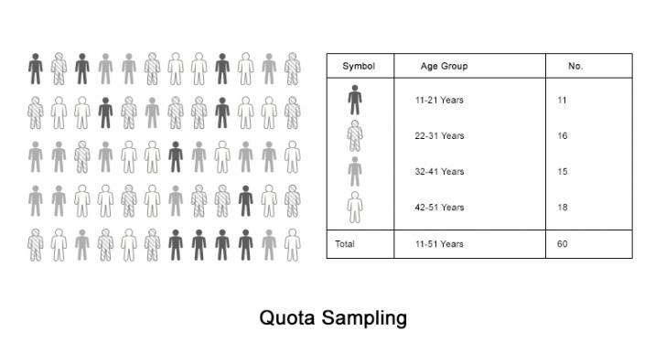
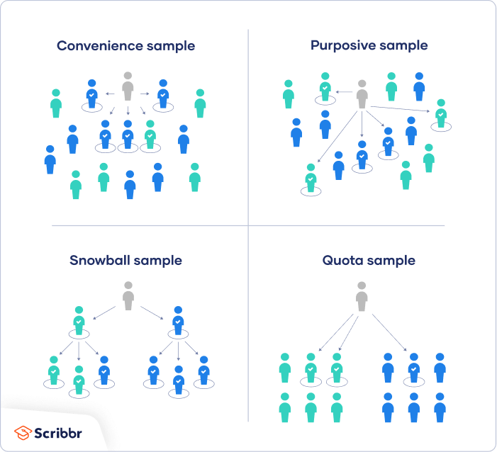
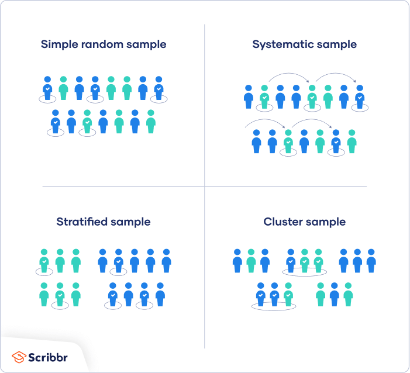
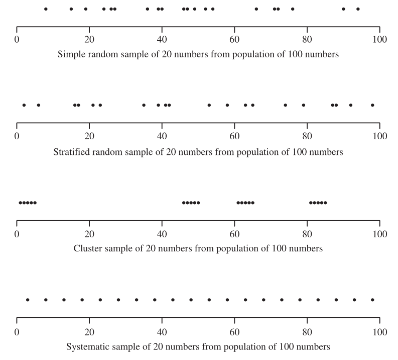

# Czym jest statystyka

::: hidden
$$
 \def\P{{\mathrm{P}}}
 \def\M{{\mathcal{P}}}
 \def\E{\mathrm{E}}
 \def\Var{\mathrm{Var}}
 \def\Bias{\mathrm{Bias}}
 \def\MSE{\mathrm{MSE}}
 \def\Cov{\mathrm{Cov}}
 \def\Cor{\mathrm{Cor}}
 \def\Tr{\mathrm{Tr}}
 \def\probit{\mathrm{probit}}
 \def\logit{\mathrm{logit}}
 \def\zb#1{{\buildrel #1 \over \longrightarrow}}
$$
:::

> Statystyka jest jak latarnia w dzień, niewiele rozświetli ale można się o nią oprzeć
>
> --- autor nieznany

**Statystyka matematyczna** zajmuje się analiza i opisywaniem zjawisk masowych przy użyciu metod rachunku prawdopodobieństwa.
Jej celem jest poznanie prawidłowości ilościowych i jakościowych w masowych zjawiskach losowych i opisywanie ich za pomocą liczb.

Jak manipulować statystyką by odnieść korzyść - czyli czy statystyka kłamie?

::: {#exm-1}
Pewna sieć telefonii komórkowej podawała niegdyś: *ponad 99% Polaków jest w zasięgu ...*

{.column-margin fig-align="center"}

Czy to oznacza, że 99% powierzchni Polski jest w zasięgu tej sieci?
Miasta charakteryzują się tym, że żyje w nich największa część ludzi posiadających telefony komórkowe, a zarazem jest tam najlepszy zasięg.
Stąd *ponad 99% Polaków jest w zasięgu ...* Ostatecznie ta statystyka, choć imponująca nie jest dla nas aż tak ważna, bowiem nas bardziej interesuje informacją jaką część Polski pokrywa dana sieć.
:::

::: {#exm-2}
Prezes pewnej firmy chwali się, że średnie zarobki w jego zakładzie są na poziomie 4500 przy średniej w regionie 2340.
Skądinąd wiemy, że struktura zarobków prezentuje się następująco (w PLN):

-   pracownicy produkcyjni: 1600, 1750, 2210, 2200, 2450, 2330;
-   szefowie działów: 5700, 8000;
-   prezes: 16000

Istotnie średnia zarobków w zakładzie pracy wynosi 4693, choć jak widać na podstawie struktury zarobków tylko trzy osoby w tym zakładzie zarabiają co najmniej na poziomie średniej płac.
Lepiej byłoby podać medianę płac (2330).

Z rozkładami tego typu będziemy się często spotykali, gdzie średnia nie jest najlepszą statystyką do opisu tendencji centralnej.

{.column-margin width="349" fig-align="center"}
:::

```{r}
#| label: fig-hist1
#| fig-cap: "Wykres przedstawia rozkład ceny diamentów i wyraźnie charakteryzuje się prawostronną asymetrią. Na wykresie historamu naniesione są mediana (zielona linia) i średnia (czerwona linia)"
library(tidyverse)
diamonds %>% 
  ggplot(aes(price))+
  geom_histogram(color = "white", bins = 10)+
  geom_vline(xintercept = mean(diamonds$price),
             color = "red",
             size = 1.5)+
  geom_vline(xintercept = median(diamonds$price),
             color = "green",
             size = 1.5)
```

::: {#exm-3}
Na poniższej grafice widzimy stosunek wydatków na walkę z pożarami a ilością pożarów w mieście.

```{r}
#| label: fig-scatter1
#| fig-cap: Wykres ilustrujący pozorną korelację
x <- c(12000, 27000, 32000, 48000, 103000, 180000)
y <- c(3, 6, 8, 11, 17, 24)
tibble(x=x,y=y) %>% 
  ggplot(aes(x,y))+
  geom_point()+
  geom_line()+
  labs(x = "Miesięczne wydatki na walkę z pożarami", y = "Liczba pożarów w miesiącu")+
  ggpubr::stat_cor()
```

Pozorny silny związek pomiędzy wydatkami na walkę z pożarami z liczbą pożarów mógłby skłonić do mniejszych wydatków na walkę z pożarami licząc na to, że spowoduje to mniejszą liczbę pożarów.
Oczywiście silny statystycznie związek nie oznacza przyczynowo skutkowej zależności, dlatego taki wniosek byłby błędny.
:::

Statystyka pomoże nam unikać tego typu błędnych interpretacji.
Mając na względzie wspomniane przykłady widzimy, że w analizie statystycznej ważne są:

-   wybór materiału statystycznego;
-   wybór metody analizy statystycznej;
-   właściwa interpretacja wyników.

# Pojęcia podstawowe

::: {#def-1}
Pojęcia podstawowe:

-   **populacja** - zbiór wszystkich przedstawicieli posiadających pewną, interesującą nas cechę;
-   **próbka** - podzbiór populacji;
-   **cecha** - czasami nazywana również charakterystyką lub zmienną, jest pewną własnością wyróżniającą z populacji pewien podzbiór;
:::

Analiza statystyczna ma na celu wskazanie pewnych własności badanych cech na podstawie próbki.
Względy finansowe, logistyczne czy czasowe nie pozwalają nam często analizować całej populacji.
Natomiast, aby wnioski na podstawie próbki były istotne (ważne i trwałe), należy zadbać aby próba była reprezentatywna.

Pojęcie próbki reprezentatywnej jest dość intuicyjne i oznacza, że nasza próbka jest jakby miniaturą całej populacji.
Reprezentatywność zawsze powinno się odnosić do badanej populacji oraz do cechy, która pozostaje w zainteresowaniu badacza.
Przykładowo, jeśli chcemy oszacować rzetelnie, na podstawie próby, zarobki Polaków, to w próbie powinny znaleźć się osoby o każdym stanie zamożności jednocześnie odwzorowując proporcje tych stanów.
Najczęściej aby zapewnić reprezentatywność próby losujemy ją.

```{r}
#| label: fig-por1
#| fig-cap: "Porównanie prób i populacji"
library(nycflights13)
set.seed(44)
proba <- flights %>% sample_n(size = 300)
library(ggpubr)
hist.pop <- gghistogram(flights, x = "air_time", y = "..density..", fill = "grey40", binwidth = 50, xlab = "Air time", title = "Population of N=336776", add = "mean")
hist.sample <- gghistogram(proba, x = "air_time", y = "..density..", fill = "grey60", binwidth = 50, xlab = "Air time", title = "Sample of n = 300", add = "mean")
ggarrange(hist.pop, ggpar(hist.sample, xlim = c(0,700)), ncol = 2)
```

::: {#def-2}
O próbie powiemy, że jest prosta jeżeli prawdopodobieństwo wylosowania każdego elementu populacji jest takie samo.
:::

::: {#def-3}
## Skale pomiarowe

W statystyce wyróżniamy następujące skale pomiarowe:

-   **nominalna** - kiedy możemy przyporządkować element do jednej grupy (nie możemy ich porównywać), np. płeć, województwo, kierunki studiów;
-   **porządkowa** - kiedy możemy przyporządkować elementy do klasy (kategorii), które możemy porównywać, np. numer na liście, miejsce na mecie w zawodach sportowych, poziom zadowolenia z życia rodzinnego w 5-cio stopniowej skali Likerta;
-   **przedziałowa** - kiedy możemy przyporządkować element do jednego z kilu przedziałów liczbowych, np. zarobki w ujęciu przedziałowym;
-   **ilorazowa** - kiedy iloraz wartości z tej skali jest liczbą rzeczywistą, np. wzrost, wiek, płace, wytrzymałość na zginanie, prędkość samochodu, itp.
:::

# Dobór próby

Shere Hite w swojej książce *Women and Love: A Cultural Revolution in Progress* [@Hite1987] przedstawia wyniki badań, które dość często były później komentowane.
Oto próbka wyników:

-   84% kobiet nie jest usatysfakcjonowanych ze swojej relacji z partnerem;
-   70% wszystkich kobiet będących w małżeństwie 5 lub więcej lat miało partnerów seksualnych poza małżeństwem;
-   95% kobiet zgłaszało formy emocjonalnego lub psychologicznego znęcania się przez mężczyzn, z którymi były w relacji partnerskiej;
-   84% kobiet zgłaszało formy protekcjonalnego zachowania ze strony mężczyzn w ich miłosnych relacjach.

W magazynie *Time* z 12 października 1987 roku pojawiła się krytyka wyników uzyskanych przez Hite'a, z wyraźną sugestią, że mają one wątpliwą wartość poznawczą.

Co było zatem nie tak z badaniem przeprowadzonym przez Hite'a?

-   Próba była "wygodna", czyli składała się wyłącznie z kobiet, które zdecydowały się odpowiedzieć na przesłaną ankietę. Hite wysłał 100000 ankiet, z czego tylko 4.5% do niego wróciło wypełnionych.
-   Ankiety zostały wysłane do organizacji zrzeszających kobiety walczące o swoje prawa, ośrodków doradczych dla kobiet czy towarzystw kościelnych. Grupy te różniły się profilem politycznym ale wszystkie skupiały wyłącznie kobiety i z tego punktu widzenia różniły się od innych kobiet nie zrzeszonych w takich grupach.
-   Ankiety zawierały 127 pytań, z czego większość składało się z wielu części.
-   Wiele z pytań było niejasnych, ponieważ zawierały niejasne pojęcia jak *miłość*. Postrzeganie tego pojęcia przez różne kobiety było inne.
-   Niektóre pytania sugerowały odpowiedź, jak np. "Czy Twój mąż/partner traktuje Cię na równi z sobą?", "Czy zdarza Ci się czuć w związku mniej ważną?"

Hite zadawał sobie pytanie *czy jeśli próba nie jest dobrana w sposób losowy ale elementów jest bardzo dużo, to czy można uogólnić wyniki na szerszą populację?*.
Sam sobie odpowiedział, że *tak*, choć większość statystyków nie ma wątpliwości, że jest przeciwnie.

## Perfekcyjna próba

W filmie *Magic Town* badacz opinii publicznej James Stewart odnalazł miasto Grandview, które ma dokładnie takie same charakterystyki dotyczące mieszkańców jak całe Stany Zjednoczone.
Miasto to miało miało taką samą proporcję osób głosujących na Republikan, tą samą proporcję ludzi na granicy ubóstwa, tą samą proporcję mechaników samochodowych, itd.

{.column-margin fig-align="center"}

Oczywiście takie perfekcyjne próby nie istnieją dla złożonych populacji (jak mieszkańcy USA).
Nawet jeśli by taka istniała, to aby to stwierdzić należałoby zbadać całą populację - co okazuje się niemożliwe.
Natomiast dobra próbka będzie **reprezentatywna** w takim sensie, że cechy nas interesujące zbiorowości generalnej mogą być oszacowane na podstawie tej próby ze znaną dokładnością.

::: {#def-4}
-   *obserwacja*[^w1-1] - to obiekt, który zostaje mierzony, np. w badaniu społeczeństwa obserwacją jest człowiek;
-   *populacja generalna*[^w1-2] - to zbiór obserwacji, które chcemy poddać badaniu, np. w badaniu preferencji wyborczej Polaków, populacją generalną może być grupa osób uprawnionych do głosowania;
-   *próba*[^w1-3] - podzbiór populacji generalnej;
-   *populacja próbkowa*[^w1-4] - zbiór wszystkich obserwacji z populacji generalnej, które mogą zostać wybrane do próby;
-   *jednostka losowania*[^w1-5] - klasa jednostek, która może zostać wybrana w procesie losowania, np. w badaniu poziomu zarobków możemy nie dysponować listą wszystkich osób objętych badaniem ale mamy spis gospodarstw domowych, które wchodzą w zakres badania;
-   *operat losowania*[^w1-6] - lista jednostek losowania z populacji próbkowej na podstawie której możemy dokonać losowania.
:::

[^w1-1]: ang.
    *observation unit*

[^w1-2]: ang.
    *target pupulation*

[^w1-3]: ang.
    *sample*

[^w1-4]: ang.
    *sampled population*

[^w1-5]: ang.
    *sampling unit*

[^w1-6]: ang.
    *sampling frame*

::: {#exm-4}
Rozważmy przykład badania preferencji wyborczej realizowanego za pomocą ankiety telefonicznej (CATI)[^w1-7]


:::

[^w1-7]: ang.
    *Computer Assisted Telephone Interview*

Doboru próby możemy dokonać na wiele sposobów:

1.  odwołując się do opinii eksperta, wybrać określone osoby do grupy badawczej - jest to tzw. dobór celowy[^w1-8] albo inaczej nieprobabilistyczny; jego popularną odmianą, jest dobór kwotowy[^w1-9], a także - absolutnie nie polecany - dobór przypadkowy składający się z obiektów "będących pod ręką"[^w1-10];
2.  można skompletować próbę na podstawie zgłoszeń ochotników[^w1-11];
3.  można też pobrać w sposób losowy[^w1-12];

[^w1-8]: ang.
    *purposive sampling*

[^w1-9]: ang.
    *quota sampling*

[^w1-10]: ang.
    *accidental sampling*

[^w1-11]: ang.
    *volunteers sampling*

[^w1-12]: ang.
    *random sampling*

Jedynie dobór losowy próby gwarantuje uzyskanie próby reprezentatywnej.
Nie mniej jednak zdarza się często, że dobór w pełni losowy nie jest możliwy do wykonania, wówczas stosuje się np.
dobór kwotowy.

## Próba celowa

Ten rodzaj doboru próby, zwany również próbkowaniem przez osąd, polega na tym, że badacz wykorzystuje swoją wiedzę do wyboru próby, która jest najbardziej przydatna do celów badania.
Jest on często stosowany w badaniach jakościowych, gdzie badacz chce zdobyć szczegółową wiedzę o konkretnym zjawisku, a nie wnioskować statystycznie, lub gdy populacja jest bardzo mała i specyficzna.
Skuteczna próba celowa musi mieć jasne kryteria i uzasadnienie włączenia.
Zawsze pamiętaj o opisaniu kryteriów włączenia i wyłączenia.

::: callout-note
## Przykład próby celowej

Chcesz dowiedzieć się więcej o opiniach i doświadczeniach studentów niepełnosprawnych na Twojej uczelni, więc celowo wybierasz kilku studentów o różnych potrzebach wsparcia, aby zebrać zróżnicowane dane na temat ich doświadczeń z usługami dla studentów.
:::

## Próba kwotowa

Próba kwotowa to rodzaj próby nieprobabilistycznej (nielosowej), o której można powiedzieć, że pozostaje w pewnym stopniu reprezentatywna dla całej populacji badanej, mimo że jednostki wchodzące w jej skład nie zostały wybrane w sposób losowy.
Wybierając respondentów do próby kwotowej bierze się najczęściej pod uwagę takie cechy jak: wiek, płeć, miejsce zamieszkania, status społeczny i zawodowy.
Dobór osób do próby wg opisanych kryteriów oparty jest na posiadanej już wiedzy o badanej populacji.
Wiemy na przykład jaki procent populacji stanowią kobiety i mężczyźni (z roczników demograficznych, spisów statystycznych itp.).
Tak więc w przypadku doboru kwotowego wg płci będzie to oznaczać, że udział procentowy kobiet i mężczyzn w próbie musi być taki sam jak ich udział procentowy w całej populacji badanej.

{width="600"}

Reprezentatywność próby kwotowej jest w pewnym sensie umowna, uzależniona od tego, jak kompletne i aktualne są dane demograficzne na podstawie których ustalamy tzw.
kwoty, czyli proporcje osób dobieranych do próby.
Nawet jeżeli mamy pewność, że dane te są w pełni aktualne, to i tak nie jesteśmy w stanie określić (w sensie matematycznym) jakim błędem losowym obciążone są wyniki zrealizowanego badania.

## Próba woluntarystyczna/ochotnicza

Wcześniej przytoczone przykłady sugerują, że próba woluntarystyczna, która jest przykładem próby wygodnej[^w1-13] , nie jest reprezentatywna.
Losowość doboru obserwacji do próby jest tylko pozorna, ponieważ faktycznie jest ona nieco tendencyjna.
Badania przeprowadzone przez [@Rosethal1991; @Rosenthal2009] wskazują pewien "portret psychologiczny" osób ochotniczo zgłaszających się do badań.
Osoby te charakteryzują się: wyższym poziomem wykształcenia, przynależnością do wyższej klasy społeczno-ekonomicznej, wyższym statusem społecznym, wyższym poziomem aprobaty społecznej, większym zsocjalizowaniem, zwiększoną tendencją do poszukiwania stymulacji, zwiększoną tendencją do zachowań niekonwencjonalnych, częściej są to kobiety (wyjątkiem są badania nad stresem gdzie przeważają mężczyźni), niższym poziomem konformizmu, pochodzą z mniejszych miast, zwiększonym zainteresowaniem religią, większym poziomem altruizmu, są bardziej otwarci.

[^w1-13]: ang.
    *convenience sample*

::: column-margin
{.column-margin fig-align="center"}
:::

::: callout-note
## Przykład próby woluntarystycznej

Wysyłasz ankietę do wszystkich studentów na swojej uczelni i wielu studentów decyduje się ją wypełnić.
To z pewnością może dać ci pewien wgląd w temat, ale osoby, które odpowiedziały, są raczej tymi, które mają silne opinie na temat usług wsparcia dla studentów, więc nie możesz być pewien, że ich opinie są reprezentatywne dla wszystkich studentów.
:::

::: callout-note
## Przykład próby wygodnej

Badasz opinie na temat form wsparcia dla studentów na Twojej uczelni, więc po każdych zajęciach prosisz swoich kolegów o wypełnienie ankiety na ten temat.
Jest to wygodny sposób zbierania danych, ale ponieważ ankietowaliście tylko studentów uczęszczających na te same zajęcia co Wy na tym samym poziomie, próba nie jest reprezentatywna dla wszystkich studentów Waszej uczelni.
:::

## Próba losowa

Próba losowa jak sama nazwa wskazuje jest dobrana w sposób losowy.
Probabilistyczny charakter pozyskiwania próby sprzyja nie tylko jej reprezentatywności ale także umożliwia badanie dokładności wnioskowania.

{.column-margin fig-align="center"}

### Rodzaje prób losowych

1.  niezależne vs zależne - różnią się tym czy po wylosowaniu elementu do próby zostanie on zwrócony do puli - w pierwszym przypadku losowanie odbywa się ze zwracaniem, a w drugim bez zwracania;
2.  indywidualne vs grupowe (zespołowe) - pierwsze odnosi się do losowań z populacji pojedynczych obserwacji (np. uczniów, pacjentów), a drugie do losowań obejmujących całe (zdefiniowane) grupy (np. klasy szkolnej, mieszkańców budynku);
3.  jednostopniowe vs wielostopniowe - w pierwszym przypadku jedno losowanie określa próbę, natomiast w drugim występuje kilka etapów (co najmniej dwa) losowania (np. w pierwszym etapie losujemy szpital a w drugim pacjentów);
4.  nieograniczone vs ograniczone - pierwsze odbywa się z całej populacji (jest jednostopniowe) a drugie polega na tym, że próbę kompletujemy na podstawie odrębnych losowań elementów z poszczególnych części populacji (warstwy), na które została ona uprzednio podzielona przez badacza (np. podział osób wg miejsca zamieszkania na grupy: wieś, miasto do 25 tyś, miasto od 25 do 100 tyś i miasto większe niż 100 tyś.).

### Odmiany schematów losowania

Można wyróżnić następujące schematy losowania:

1.  losowanie nieograniczone indywidualne,
2.  losowanie systematyczne indywidualne,
3.  losowanie warstwowe[^w1-14],
4.  losowanie grupowe[^w1-15],
5.  losowanie wielostopniowe

[^w1-14]: ang.
    *stratified sampling*

[^w1-15]: ang.
    *cluster sampling*

### Losowanie nieograniczone indywidualne

Losowanie tego typu jest najprostszym sposobem doboru próby losowej.
Jednakże jest ono mało efektywne i dlatego w praktyce badawczej stosuje się najczęściej inne rozwiązania.
Ten sposób losowania wybieramy wówczas gdy mamy niezbyt dużą populację, a jednocześnie mamy o niej mało informacji oraz gdy jest ona homogeniczna.
Losowanie nieograniczone indywidualne polega na tym, iż próbę pobieramy z całej, nie podzielonej na części populacji.
Losowanie przeprowadzamy w sposób bezzwrotny, gdyż jest to sposób najbardziej korzystny.

::: callout-note
## Przykład losowania nieograniczonego indywidualnego

Losowano 20 liczb całkowitych ze 100.

`r sample(1:100, size = 20)`
:::

### Losowanie systematyczne indywidualne

Schemat losowania systematycznego indywidualnego polega na wylosowaniu co $k$-tego obiektu z populacji zaczynając od pewnego losowego elementu.
Załóżmy, że mamy $N$ elementową populację i chcemy z niej pobrać próbę o liczebności $n$.
Pierwszy krok to ustalenie tzw.
odstępu losowania - $k$, który jest równy całości z liczby $\tfrac{N}{n}$.
Drugi krok, to wybór losowy liczby naturalnej $N_0$ spełniającej warunek $$1\leq N_0 \leq k.$$ Wówczas próba składa się z elementów o numerach $$N_0, N_0+k, N_0+2k, N_0+3k, \ldots.$$ Schemat ten musimy jednak stosować ostrożnie, ponieważ jeśli w populacji występuję pewna cykliczna zależność, to ten sposób losowania może dostarczyć błędnych informacji.

{.column-margin fig-align="center"}


### Losowanie warstwowe

Gdy populacja wykazuje duże zróżnicowanie ze względu na badaną zmienną, losowanie nieograniczone indywidualne może nam nie dać adekwatnego obrazu, gdyż pewne części populacji mogą być reprezentowane w próbie zbyt licznie lub niedostatecznie.
Wówczas można zastosować schemat losowania warstwowego, polegającego na podzieleniu całej populacji na warstwy i losowaniu z każdej warstwy określonej liczby elementów.
Warstwy odwzorowują proporcje występujące w populacji, a liczba losowanych z nich obiektów powinna te proporcje uwzględniać.
Istnieją dwa warianty losowania warstwowego:

-   *proporcjonalny* - wielkość prób losowych z warstw jest proporcjonalna do wielkości samych warstw; jeśli $n$ oznacza wielkość próby, na którą składają się próby o wielkości $n_w$ losowane z warstw, a $p_w$ oznacza proporcję elementów z danej warstwy w całej populacji, to wielkość próby, którą powinniśmy wylosować z warstwy obliczamy wg wzoru $$n_w=n\cdot p_w.$$
-   *optymalny* - wielkość próby, która ma być wylosowana z każdej warstwy jest proporcjonalna nie tylko do wielkości samych warstw, ale także do wielkości odchylenia standardowego badanej zmiennej w określonej warstwie.

::: callout-note
## Przykład próby warstwowej

W firmie jest 800 pracowników płci żeńskiej i 200 pracowników płci męskiej.
Chcesz mieć pewność, że próbka odzwierciedla równowagę płci w firmie, więc sortujesz populację na dwie warstwy w oparciu o płeć.
Następnie używasz losowego doboru próby na każdej grupie, wybierając 80 kobiet i 20 mężczyzn, co daje reprezentatywną próbę 100 osób.
:::

### Losowanie grupowe

Cechą charakterystyczną tego losowania jest to, że jednostkami losowania nie są poszczególne elementy populacji, ale ich skupiska, czy grupy.
Znajduje zastosowanie tam, gdzie populacja jest bardzo liczna i jednocześnie brak rzetelnego operatu losowania.
Przykładowo jeśli chcemy wylosować próbę reprezentatywną z populacji liczącej kilka milionów osób, to możemy mieć problem ze stworzeniem właściwego operatu losowania a po drugie koszt takich badań byłby bardzo wysoki ze względu na aspekty logistyczne.
Mniej wysiłku włożymy w dobór próby, jeśli elementy populacji połączymy w zespoły wg określonego kryterium.
Najczęściej stosowane są gotowe, funkcjonujące już w świecie naturalne podziały, jak: klasa szkolna, szpital, gmina, wieś, kierunek studiów.
Operatem losowania dla schematu grupowego jest ponumerowany spis grup, a mechanizmem losowania mogą być tablice liczb losowych.

::: callout-note
## Przykład próby grupowej

Firma ma biura w 10 miastach w całym kraju (wszystkie z mniej więcej taką samą liczbą pracowników na podobnych stanowiskach).
Nie masz możliwości udania się do każdego biura, aby zebrać dane, więc używasz losowego doboru próby, aby wybrać 3 biura - to są twoje klastry.
:::

### Losowanie wielostopniowe

Schemat ten jest kombinacją omówionych wyżej schematów losowania.
Przykładowo w pierwszym etapie losowania wybieramy na podstawie odpowiedniego operatu losowania próbę złożoną z $k$ grup (etap losowania grupowego).
W drugim etapie sporządzamy dla każdej z $k$ grup odrębny operat losowania i losujemy z każdej grupy pewną liczbę elementów (etap losowania nieograniczonego indywidualnego).
W losowaniu wielostopniowym zakładamy, że poszczególne losowania są od siebie niezależne.

Rozpatrzmy przykład losowania wielostopniowego mającego na celu dobór uczniów klas VII z populacji szkół podstawowych dużego miasta.
Można wówczas potraktować dzielnice miasta jako warstwy, a szkoły jako grupy.
Wówczas przebieg losowania byłby następujący:

1.  wylosowanie z każdej dzielnicy $k$ szkół podstawowych;
2.  wylosowanie z każdej szkoły jednej klasy VII;
3.  wylosowanie z każdej klasy VII $l$ uczniów.



::: {#exm-5}
Czasami prób losowa może nieco odbiegać o tego, czego byśmy się spodziewali.

```{r}
round(prop.table(table(proba$carrier)),3)
round(prop.table(table(flights$carrier)),3)
```

Jak widać w powyższym przykładzie niektóre stany zmiennej `carrier` nie są reprezentowane w próbie o liczebności $n=300$, a inne są reprezentowane w innej proporcji niż w populacji.
Nie można jednak "poprawiać" tej próby, proponuje się za to losowanie warstwowe.
:::

## Obciążenie selekcyjne

Obciążenie selekcyjne[^w1-16] zachodzi jeśli część populacji generalnej nie znajduje się w populacji próbkowej lub gdy pewne obserwacje w populacji są wylosowane do próby z inną częstością niż zakładana.
Przykładowo jeśli próbujemy "poprawić" próbę poprzez dobranie obiektów, które wg naszego uznania zachowują się "przeciętnie", powodujemy że próba staje się tendencyjna i możemy zgodnie z naszym zamiarem potwierdzić hipotezę, która nie koniecznie jest prawdziwa.
W wyborach gubernatora stanu Arizona w 1997 roku została przedstawiona predykcja na podstawie prawyborów, wg której Eddie Basha przegrywał 9% z innym kandydatem.
Ostatecznie Basha zdobył 37% i wygrał.
Skąd zatem taka pomyłka w sondażu?
Otóż, przewidywania były oparte o osoby, które brały udział w poprzednich prawyborach i chciały wziąć udział w kolejnych.
Natomiast Basha miał bardzo duże poparcie w obszarach wiejskich, które nie brały udziału w poprzednich prawyborach [@Lohr2009].

[^w1-16]: ang.
    *selection bias*

Obciążenie selekcyjne może pojawić się z dwóch powodów: nadreprezentacji lub niedoreprezentowania.
Pierwsze oznacza, że w próbie znalazły się obiekty spoza populacji generalnej, a w drugim przypadku część populacji nie została reprezentowana w próbie.

