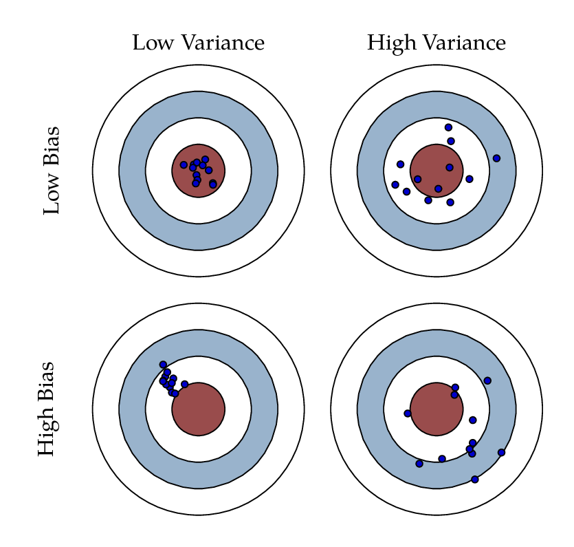

::: hidden
$$
 \def\P{{\mathrm{P}}}
 \def\M{{\mathcal{P}}}
 \def\E{\mathrm{E}}
 \def\Var{\mathrm{Var}}
 \def\Bias{\mathrm{Bias}}
 \def\MSE{\mathrm{MSE}}
 \def\Cov{\mathrm{Cov}}
 \def\Cor{\mathrm{Cor}}
 \def\Tr{\mathrm{Tr}}
 \def\probit{\mathrm{probit}}
 \def\logit{\mathrm{logit}}
 \def\zb#1{{\buildrel #1 \over \longrightarrow}}
$$
:::

# Estymacja punktowa

## Estymatory i ich własności

Każdy estymator $\hat{\theta}$ wyznaczony na podstawie próby charakteryzuje się pewnym błędem oszacowania prawdziwej wartości $\theta$, tą wielkość oznaczamy

$$
  \Bias(\hat{\theta})=\E(\hat{\theta})-\theta.
$$

Jeśli $\Bias(\hat{\theta})=0$, to mówimy o nim, że jest *nieobciążony*.
Inny parametr opisujący jakość estymatora, to *wariancja* określona jako $$
  \Var(\hat{\theta})=\E(\hat{\theta}-\E(\hat{\theta}))^2.
$$

Oczywiście im mniejsza jest wariancja estymatora, tym jest on lepszy.

Ponieważ, czasem używamy estymatorów obciążonych, to do pomiaru precyzji estymatora używamy *błędu średniokwadratowego*[^w1-17] określonego następująco

[^w1-17]: ang.
    *mean square error*

$$
  \MSE(\hat{\theta})=\E(\hat{\theta}-\theta)^2=\Var(\hat{\theta})+[\Bias(\hat{\theta})]^2.
$$



## Przegląd estymatorów

Oto przegląd głównych estymatorów:

1.  **Średnia**

-   (dane pogrupowane) - $\overline{x}=\frac 1n\sum_{i=1}^k \dot{x}_in_i$, gdzie $\dot{x}_i$ oznacza środek i-tego przedziału, $n_i$ liczebność i-tego przedziału;
-   (dane niepogrupowane) - $\overline{x}=\frac 1n\sum_{i=1}^n x_i$

2.  **Mediana**

-   (dane pogrupowane) - $M_e=x_l +\frac b{n_m}\left(\frac n2-\sum_{i=1}^{m-1}n_i\right)$, gdzie $x_l$ oznacza lewy koniec przedziału zawierającego medianę, $n_m$ liczebność przedziału zawierającego medianę, $m$ numer przedziału zawierającego medianę ;

-   (dane niepogrupowane) -

    $$
    M_e=\begin{cases}x_{((n+1)/2)}, & n \text{ nieparzyste};\\\frac 12 (x_{(n/2)}+x_{(n/2+1)}), & n \text{ parzyste},\end{cases}
    $$

    gdzie $x_{(i)}$ oznacza $i$-tą wartość próbki uporządkowanej niemalejąco.

3.  **Moda (dominanta)**

-   (dane pogrupowane) - $M_o=x_l+\frac{n_m-n_{m-1}}{2n_m-n_{m-1}-n_{m+1}}b$, gdzie $x_l$ oznacza lewy koniec przedziału zawierającego modę, $n_m$ liczebność przedziału zawierającego modę;
-   (dane niepogrupowane) - Najczęściej powtarzająca się wartość $x_i$ o ile nie jest to $x_{\max}$ lub $x_{\min}$.

4.  **Wariancja**

-   (dane pogrupowane) $S^2=\frac 1n\sum_{i=1}^k (\dot{x}_i-\overline{x})^2n_i$ lub $\hat{S}^2=\frac 1{n-1}\sum_{i=1}^k (\dot{x}_i-\overline{x})^2n_i$;
-   (dane niepogrupowane) $S^2=\frac 1n\sum_{i=1}^n (x_i-\overline{x})^2$ lub $\hat{S}^2=\frac 1{n-1}\sum_{i=1}^n (x_i-\overline{x})^2$;

5.  **Odchylenie standardowe** - $S=\sqrt{S^2}$ lub $\hat{S}=\sqrt{\hat{S}^2};$
6.  **Współczynnik zmienności** $V=\frac{\hat{S}}{\bar{x}}$ lub $V=\frac{S}{\bar{x}};$
7.  **Współczynnik asymetrii** $A=\frac{\mu_3}{S^3};$
8.  **Kurtoza** $K=\frac{\mu _4}{S^4},$ gdzie $\mu_k=\frac1n\sum_{i=1}^n(x_i-\bar{x})^k.$

## Przykłady różnych rozkładów

```{r}
#| fig-cap: "Przykład rozkładu prawostronnie asymetrycznego ($\\chi^2(3)$)"

library(tidyverse)
ggplot()+
  xlim(0,20)+
  geom_function(fun = dchisq, args = list(df = 3))
```

```{r}
#| fig-cap: "Przykład rozkładu lewostronnie asymetrycznego ($\\chi^2(3)$ na odwrotnej dziedzinie)"
odw <- function(x,...) dchisq(20-x,...)
ggplot()+
  xlim(0,20)+
  geom_function(fun = odw, args = list(df = 3))
```

```{r}
#| label: fig-kurt
#| fig-cap: "Przykłady rozkładów o różnej kurtozie. Rozkład normalny - mezokurtyczny, rozkład Laplace'a - leptokurtyczny i rozkład jednostajny - platokurtyczny"
ggplot()+
  xlim(-5,5)+
  geom_function(aes(colour = "normal"), fun = dnorm)+
  geom_function(aes(colour = "laplace"), fun = VGAM::dlaplace, args = list(location = 0, scale = 1))+
  geom_function(aes(colour = "uniform"), fun = dunif, args = list(min = -3, max = 3))
```

::: {#def-5}
Ekscesem nazywamy wielkość określającą o ile kurtoza rozkładu przekracza wartość 3, która jest kurtozą rozkładu normalnego.
:::

Odpowiednio ekscesami rozkładów prezentowanych na wykresie @fig-kurt są:

-   normalny = 0,
-   Laplace'a = 3;
-   jendostajny = -6/5.

Rozpocznijmy od przykładu przedstawiającego zastosowanie statystyk opisowych

::: {#exm-1}
Dane są zarobki pracowników w pewnej firmie, które prezentują się następująco:

```{r}
library(tidyverse)
library(gt)
zarobki <- c(23400, 40400, 29400, 24800, 31200, 21800, 19800, 24600, 25900,
             18800, 21300, 20200, 22000, 24500, 27000, 24600, 36600, 19100,
             24200, 38100, 18900, 19500, 24700, 20800, 19100, 33600, 20600,
             26400, 22300, 21100, 25000, 23600, 30500, 20700, 24800, 25000,
             25000, 23700, 25900, 26900, 32000, 21400, 19600, 23300, 21900,
             24700, 25700, 27900, 30400, 24600, 26500, 21700, 20400, 23500,
             42400, 24900, 23800, 21300, 21500, 19700, 23700, 23800, 18900,
             22800, 21900, 18100, 20300, 23200, 21500, 21300, 23700, 33100,
             23400, 22600, 20600, 21900, 20500, 16000, 19200, 18300, 29800,
             21200, 25300, 31700, 26300, 20200, 22400, 18400, 35100, 18400,
             20000, 32700, 29300, 31200, 25200, 21600, 24600, 31600, 26200,
             33200)
zarobki |> 
  matrix(ncol = 5) |> 
  knitr::kable()  
  
```

Postaramy się opisać rozkład badanej cechy za pomocą poznanych statystyk z poprzedniego wykładu.

```{r}
dt <- data.frame(zarobki = zarobki)
dt %>% 
  ggplot(aes(zarobki))+
  geom_histogram(color = "white", bins = 10)
```

Na podstawie powyższego wykresu histogramu możemy przypuszczać, że rozkład będzie się charakteryzował prawostronną asymetrią, co oznacza, że prawdopodobnie moda będzie występowała wcześniej niż mediana, a ta wcześniej niż średnia.
Ilustracja rozkładu może być równie dobrze wykres ramka-wąsy i wykres gęstości.

```{r}
p1 <- dt %>% 
  ggplot(aes(x = 1, y = zarobki))+
  geom_boxplot()
p2 <- dt %>% 
  ggplot(aes(zarobki))+
  geom_density(fill = "grey")
cowplot::plot_grid(p1,p2)
```

Na nich również widać prawostronną asymetrię.

Teraz obliczymy statystyki opisowe dla analizowanej zmiennej

::: column-body-outset
```{r}
library(psych)
# brakuje jedynie mody
describe(dt$zarobki) |> 
  select(-vars, -mad, -trimmed, -se) |> 
  gt() |> 
  fmt_number(columns = 2:last_col(), decimals = 1)
```

Oddzielnie zostanie policzona moda (ponieważ nie została ona ujęta w żadnym pakiecie do obliczania statystyk opisowych i samodzielnie musimy ją policzyć).

```{r}
find_mode <- function(x) {
  u <- unique(x)
  tab <- tabulate(match(x, u))
  u[tab == max(tab)]
}
find_mode(zarobki)
```
:::

## Interpretacja wyników

Na podstawie statystyk wyliczonych powyżej możemy stwierdzić, że zarobki w badanej grupie kształtowały się w przedziale od 16000 do 42400.
Średni poziom zarobków był na poziomie 24522, a mediana ma poziomie 23650, co potwierdza przypuszczenie, że ze względu na prawostronną asymetrię średnia będzie przyjmowała większą wartość niż mediana.
Moda (czyli ostatnia z miar tendencji centralnej) kształtuje się na poziomie 24600 i jest większa od średniej i mediany, a to nie jest typowe zjawisko.
Należy jednak nadmienić, że moda jest bardzo wrażliwa na heterogeniczność badanej cechy.
Do oceny zmienności (czasami nazywanej dyspersją) używamy najczęściej odchylenia standardowego, ponieważ wyraża zmienność w jednostkach mierzonej wielkości (w naszym przypadku \$).
Do oceny zmienności można też wykorzystać wariancję ale ta mierzy dyspersję w kwadratach jednostek.
W naszej próbie odchylenie standardowe wynosi 5105.8.
Trudno dokonać oceny czy jest to duża czy mała zmienność jeśli nie odniesiemy tej wielkości do poziomu analizowanego zjawiska.
Najczęściej tak jak w definicji współczynnika zmienności odnosimy to do średniej arytmetycznej.
W tym przypadku CV=20.8%, co oznacza małą zmienność.
Nie istnieje jedna wykładnia do interpretacji wielkości zmienności na podsatwie CV ale dominująca w literaturze każe przyjmować następujące przedziały:

-   mała zmienność - 0%-30%
-   umiarkowana zmienność - 30%-70%
-   duża zmienność - \>70%

Współczynnik asymetrii w naszym przykładzie wynosi 1.22 co potwierdza wyraźną asymetrię prawostronną.
Gdyby ten współczynnik był mniejszy od 0, mówilibyśmy o asymetrii lewostronnej.
Przyjmuje się też traktować rozkłady których $|A|<0.5$ jako symetryczne.
Eksces na poziomie 1.36 oznacza, że kurtoza wynosi 4.36 a interpretujemy ten fakt w ten sposób, że koncentracja zarobków wokół średniej jest wyższa niż w rozkładzie normalnym.
:::