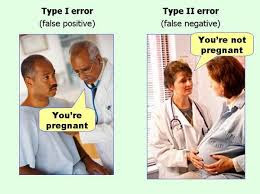
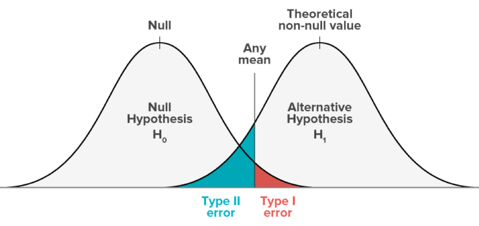
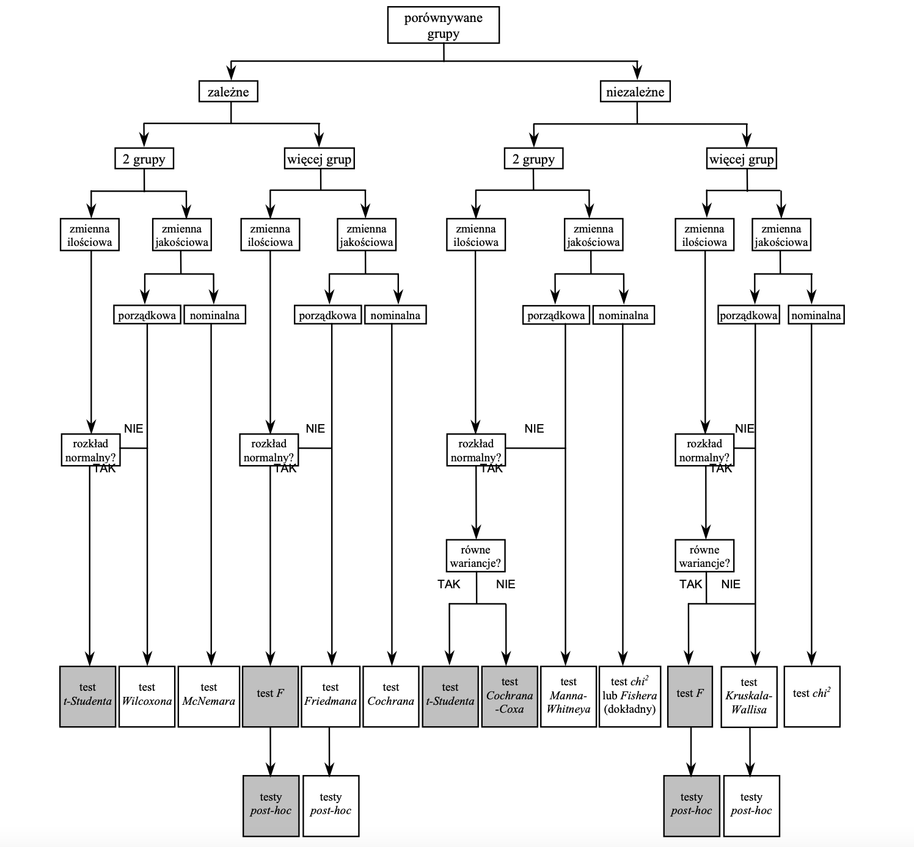
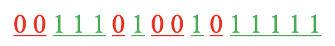
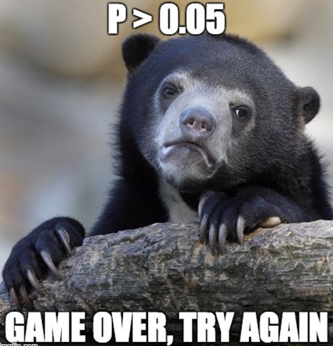

::: hidden
$$
 \def\P{{\mathrm{P}}}
 \def\M{{\mathcal{P}}}
 \def\E{\mathrm{E}}
 \def\Var{\mathrm{Var}}
 \def\Cov{\mathrm{Cov}}
 \def\Cor{\mathrm{Cor}}
 \def\Tr{\mathrm{Tr}}
 \def\probit{\mathrm{probit}}
 \def\logit{\mathrm{logit}}
 \def\zb#1{{\buildrel #1 \over \longrightarrow}}
$$
:::

# Weryfikacja hipotez


Z punktu widzenia badacza, który na bazie dotychczasowej wiedzy i badań (często empirycznych) stawia pewne hipotezy i szuka odpowiedzi na nie, ważnym staje się optymalna metoda oceny prawdziwości postawionych tez.
Hipotezy te mogą dotyczyć zarówno parametrów rozkładów badanych cech jak i zależności między cechami czy sama rodzina rozkładów do której przynależą.

Postawowymi pojęciami w zagadnieniu weryfikacji hipotez są:\pause{}

-   przestrzeń próbek $\mathcal{X}$,
-   rodzina rozkładów $\{\P_{\theta}:\theta\in\Theta\}$ określona na przestrzeni $\mathcal{X}$,
-   *hipotezy statystyczne*,
-   *test statystyczny*.

::: {#def-1}
Hipotezą nazywamy twierdzenie, z którego wynika, że prawdziwy rozkład prawdopodobieństwa, opisujący naturalną zmienność wyników obserwacji, należy do pewnego podzbioru właściwego rodziny możliwych rozkładów prawdopodobieństwa.
Dla konkretnego modelu statystycznego $(\mathcal{X},\{\P_{\theta}:\theta\in\Theta\})$ hipotezę statystyczną określamy jako podzbiór $\Theta_0$ zbioru $\Theta$.
:::

Wśród hipotez wyróżniamy:

-   **hipotezę zerową** (zwaną czasem główną) $\Theta_0$;
-   **hipotezę alternatywną** $\Theta_1$.

Będziemy używali następującego oznaczenia: $H_0=\{\theta:\theta\in \Theta_0\}$\pause{} oraz $H_1=\{\theta:\theta\in\Theta_1\}$.

::: {#def-2}
Testem statystycznym nazywamy procedurę, która pozwala nam na podstawie próbki odrzucić lub przyjąć stawianą hipotezę.
:::

Test statystyczny składa się z:

-   **statystyki testowej** - wielkość obliczona na podstawie próbki, której rozkład jest znany przy założeniu, że prawdziwa jest hipoteza zerowa;
-   **zbioru krytycznego** - to zbiór lub przedział liczbowy, tak dobrany, że gdy statystyka testowa należy do tego zbioru, to jesteśmy zmuszeni odrzucić hipotezę zerową na korzyść alternatywnej.

::: collout-note
Jeśli statystyka testowa nie należy do zbioru krytycznego, to mówimy, że nie ma podstaw do odrzucenia hipotezy $H_0$.
Jeśli statystyka testowa należy do zbioru krytycznego, to odrzucamy hipotezę zerową na korzyść hipotezy alternatywnej.
:::

## Rodzaje hipotez

Wśród hipotez statystycznych wyróżniamy:

-   **hipotezy parametryczne** - uściśla poziom badanego parametru (bądź parametrów) rozkładu, np $H_0:\mu=2,93$ lub $H_1:\sigma_1^2>\sigma_2^2$;
-   **hipotezy nieparametryczne** - określa rodzinę rozkładów badanej cechy, zależność między cechami, np $H:\{$zmienna losowa $X$ ma rozkład wykładniczy$\}$.

W tej części wykładu będziemy się zajmowali jedynie hipotezami parametrycznymi.
W kolejnych wykładach przedstawimy testy nieparametryczne.

W ramach hipotez parametrycznych wyróżniamy:

-   **hipoteza prosta** - jeśli przy założeniu prawdziwości hipotezy wiemy dokładnie, który z rodziny $\{\P_{\theta}:\theta\in\Theta\}$ rozkład jest prawdziwy, np $H_0:\mu=8,5$;
-   **hipoteza złożona** - precyzuje podzbiór właściwych rozkładów z rodziny $\{\P_{\theta}:\theta\in\Theta\}$ przy założeniu prawdziwości hipotezy, np $H_1:\sigma^2>3$.

## Błędy weryfikacyjne

Stosując nawet najlepsze testy statystyczne musimy się liczyć z tym, że możemy popełnić błąd nie odrzucając lub odrzucając hipotezę $H_0$.

{width="400"}

::: {#def-3}
Błędem I rodzaju (ang. *false positive*) nazywamy sytuację, w której odrzucimy hipotezę $H_0$ wówczas gdy ona była prawdziwa.
Błędem II rodzaju (ang. *false negative*) nazywamy sytuację, w której przyjmujemy hipotezę $H_0$ podczas gdy jest ona fałszywa.
:::

```{r}
#| label: tab-1
#| tbl-cap: Rodzaje błędów weryfikacyjnych
#| echo: false

library(flextable)
library(tidyverse)
tab <- data.frame(
  Decyzja = c("H0", "H1"),
  `jest prawdziwa` = c("decyzja poprawna", "błąd I rodzaju"),
  `jest fałszywa` = c("błąd II rodzaju", "decyzja poprawna"),
  check.names = F
)
tab |> 
  flextable() %>%
  # mk_par(i = 1:2, j = 1, part = "body",
  #        value = as_paragraph(
  #          as_equation(.,width = .1, height = .2)),
  #        use_dot = TRUE) %>%
  add_header_row(values = c(" ", "Hipoteza"), colwidths = c(1,2)) |> 
  autofit()
```

Dodatkowo jeśli $W$ jest zbiorem krytycznym a $\delta(x)$ jest statystyką testową próby $x$, to możemy określić następujące prawdopodobieństwa:

```{=tex}
\begin{equation}
    \alpha(\theta)=\P_{\theta}\{\delta(x)\in W\}\quad \text{dla} \quad \theta\in H_0,
\end{equation}
```
```{=tex}
\begin{equation}
    \beta(\theta)=\P_{\theta}\{\delta(x)\notin W\}\quad \text{dla} \quad \theta\in H_1.
\end{equation}
```
Co do zasady w statystyce przyjęło się wybierać taki test statystyczny aby minimalizował prawdopodobieństwo błędu II rodzaju przy ustalonym prawdopodobieństwie błędu I rodzaju $\alpha$, zwanym **poziomem istotności**.

::: {#def-4}
**Mocą testu** nazywamy wielkość $1-\beta(\theta)$.
:::

Warto zauważyć, że nie jest możliwe zminimalizowanie jednocześnie błędu I i II rodzaju.



## Pojedyncze testy istotności dla $\mu$

### Model 1

Badana cecha $X$ ma rozkład $N(\mu,\sigma^2)$ o znanym $\sigma^2$.
Do weryfikacji hipotezy $H_0:\mu=\mu_0$ wykorzystujemy statystykę

```{=tex}
\begin{equation}
  U=\frac{\bar{x}-\mu_0}{\sigma}\sqrt{n},
\end{equation}
```
która przy założeniu prawdziwości hipotezy $H_0$ ma rozkład $N(0,1)$.

1.  Jeśli $H_1:\mu<\mu_0$ wtedy $W=(-\infty,-u_{2\alpha}]$;
2.  Jeśli $H_1:\mu>\mu_0$ wtedy $W=[u_{2\alpha},\infty)$;\pause{}
3.  Jeśli $H_1:\mu\neq\mu_0$ wtedy $W=(-\infty,-u_{\alpha}]\cup [u_{\alpha},\infty),$

gdzie $\P(|U|>u_{p})=p.$

Przedziały krytyczne $W$ można graficznie przedstawić następująco

```{r}
#| fig-cap: "Przedziały krytyczne dla hipotezy dwustronnej ($\\alpha = 0.05$ oraz $\\alpha=0.1$)"
#| echo: false
#| fig-height: 3
library(tidyverse)
library(mosaic)
library(cowplot)
p1 <- xqnorm(p = c(0.025, 0.975),
             digits = 2, 
             system = "gg", 
             return = "plot", 
             pattern = "rings") %>% 
  gf_theme(theme = theme(legend.position = "bottom"))
p2 <- xqnorm(p = c(0.05, 0.95), 
             digits = 2, 
             system = "gg", 
             return = "plot", 
             pattern = "rings") %>% 
  gf_theme(theme = theme(legend.position = "bottom"))
plot_grid(p1,p2)
```

a w przypadku hipotez jednostronnych

```{r}
#| fig-cap: "Przedział krytyczny dla hipotezy $H_1:\\mu>\\mu_0$ i $\\alpha=0.05$"
#| echo: false
#| fig-height: 3
xqnorm(c(0,0.95), digits = 2, system = "gg", return = "plot")
```

### Model 2

Badana cecha $X$ ma rozkład $N(\mu,\sigma^2)$ o nieznanych parametrach.
Do weryfikacji hipotezy $H_0:\mu=\mu_0$ wykorzystujemy statystykę \begin{equation}
  T=\frac{\bar{x}-\mu_0}{\hat{S}}\sqrt{n},
\end{equation}

która przy założeniu prawdziwości $H_0$ ma rozkład t-Studenta o $n-1$ stopniach swobody.

1.  Jeśli $H_1:\mu<\mu_0$ wtedy $W=(-\infty,-t_{2\alpha,n-1}]$;
2.  Jeśli $H_1:\mu>\mu_0$ wtedy $W=[t_{2\alpha;n-1},\infty)$;
3.  Jeśli $H_1:\mu\neq\mu_0$ wtedy $W=(-\infty,-t_{\alpha;n-1}]\cup [t_{\alpha;n-1},\infty),$

gdzie $\P(|T|>t_{p;n-1})=p.$

```{r}
#| fig-cap: "Przedział krytyczny dla hipotezy $H_1:\\mu\\neq\\mu_0$, $\\alpha=0.05$ i liczby stopni swobody 5"
#| echo: false
#| fig-height: 3
xqt(p = c(0.025, 0.975), 
    df = 5,
    digits = 2, 
    system = "gg", 
    return = "plot", 
    pattern = "rings")
```

### Model 3

Badana cecha $X$ ma rozkład dowolny o nieznanych parametrach.
Jeśli $n\geq 100$ oraz $\sigma<\infty$, to do weryfikacji hipotezy $H_0:\mu=\mu_0$ wykorzystujemy statystykę

```{=tex}
\begin{equation}
  U=\frac{\bar{x}-\mu_0}{\hat{S}}\sqrt{n},
\end{equation}
```
która przy założeniu prawdziwości $H_0$ ma rozkład $N(0,1)$.

1.  Jeśli $H_1:\mu<\mu_0$ wtedy $W=(-\infty,-u_{2\alpha}]$;\pause{}
2.  Jeśli $H_1:\mu>\mu_0$ wtedy $W=[u_{2\alpha},\infty)$;\pause{}
3.  Jeśli $H_1:\mu\neq\mu_0$ wtedy $W=(-\infty,-u_{\alpha}]\cup [u_{\alpha},\infty),$

gdzie $\P(|U|>u_{p})=p.$

## Krytyczny poziom istotności

<div>

**Krytycznym poziomem istotności** $p$ nazywamy prawdopodobieństwo, przy którym jesteśmy zmuszeni zmienić decyzję weryfikacyjną na przeciwną, przy zadanym poziomie ufności.

</div>

Jeśli odległość $|p-\alpha|$ jest stosunkowo "duże", to możemy przyjąć, że podjęta decyzja weryfikacyjna jest jednoznaczna.
Natomiast jeśli odległość ta jest "mała", to decyzja weryfikacyjna jest niejednoznaczna (rozmyta).
Określenia "mała" i "duża" są subiektywne ale często przyjmuje się następujące kryteria:

-   Jeżeli $\alpha>p$, to decyzję o odrzuceniu hipotezy zerowej uznajemy za jednoznaczną, gdy $p<0,01$;
-   Jeżeli $\alpha<p$, to decyzja o nie odrzuceniu hipotezy zerowej jest jednoznaczna, gdy $p>0,1$.

::: {#exm-1}
Standardowy środek znieczulający zaczyna działać średnio po 10,5 min. od chwili podania.
Producent nowego środka znieczulającego twierdzi, że jego specyfik działa zdecydowanie szybciej.
Dentysta aplikuje nowy środek 10 pacjentom, mierząc czas (w min.) po którym pacjent przestaje odczuwać ból.
Otrzymał następujące dane:

```{=tex}
\begin{equation}
  9.3, 9.5, 9.2, 9.0, 9.3, 9.5, 9.4, 9.3, 9.2, 9.1.
\end{equation}
```
Ponieważ wiadomo, że rozkład czasu po którym zaczynał działać dotychczas stosowany środek był normalny, można przypuszczać, że również rozkład dla nowego środka będzie normalny.
Sprawdź na poziomie istotności $\alpha=0,05$ czy nowy środek działa szybciej.
:::

**Rozwiązanie:**

$H_0:\mu=10,5$, $H_1:\mu<10,5$, $\alpha=0,05$.

Wybieramy model II.

```{=tex}
\begin{equation}
  \bar{x}=\frac{1}{10}\sum_{i=1}^n x_i=9,28
\end{equation}
```
oraz

```{=tex}
\begin{equation}
  \hat{S}^2=\frac{1}{n-1} \sum_{i=1}^n (x_i-\bar{x})^2=0,0262,
\end{equation}
```
stąd

```{=tex}
\begin{equation}
T=\frac{\bar{x}-\mu_0}{\hat{S}}\sqrt{n}=\frac{9,28-10,5}{0,1619}\sqrt{10}=-23,82.
\end{equation}
```
Dla naszej hipotezy alternatywnej zbiór krytyczny przedstawia się następująco $W=(-\infty,-t_{2\alpha;n-1}]$, więc obliczamy $t_{0,1;9}=1,833,$ stąd $W=(-\infty,-1,833].$

**Odpowiedź:**

Ponieważ $T\in W$, więc na poziomie istotności $\alpha=0,05$ odrzucamy hipotezę $H_0$ na rzecz hipotezy $H_1$, czyli istnieją podstawy by stwierdzić, że nowy środek znieczulający działa szybciej.

::: callout-tip
## Rozwiązanie w R

```{r}
#| echo: true
proba <- c(9.3, 9.5, 9.2, 9.0, 9.3, 9.5, 9.4, 9.3, 9.2, 9.1)
t.test(proba, mu = 10.5, alternative = "less")
```

Ponieważ $p=9.65*10^{-10}<0.05$ to odrzucamy hipotezę $H_0$ na korzyść $H_1$.
Wniosek jest ten sam, ale znając wartość $p$ możemy stwierdzić, że decyzja jest jednoznaczna.
:::

## Pojedyncze testy istotności dla $\sigma$ lub $\sigma^2$

### Model 1

Badana cecha $X$ ma rozkład $N(\mu,\sigma^2)$ o nieznanych parametrach.
Do weryfikacji hipotezy $H_0:\sigma=\sigma_0$ lub $H_0:\sigma^2=\sigma^2_0$ wykorzystujemy statystykę

```{=tex}
\begin{equation}
  \chi^2=\frac{(n-1)\hat{S}^2}{\sigma^2_0},
\end{equation}
```
która przy założeniu prawdziwości $H_0$ ma rozkład $\chi^2$ o $n-1$ stopniach swobody.
Dla hipotezy alternatywnej $H_1$ dobieramy odpowiedni zbiór krytyczny:

1.  Jeśli $H_1:\sigma>\sigma_0,$ wtedy $W=[\chi^2_{\alpha;n-1},\infty)$;
2.  Jeśli $H_1:\sigma<\sigma_0,$ wtedy $W=(0,\chi^2_{1-\alpha;n-1}]$;
3.  Jeśli $H_1:\sigma\neq\sigma_0,$ wtedy $W=(0,\chi^2_{1-\frac{\alpha}{2};n-1}]\cup [\chi^2_{\frac{\alpha}{2};n-1},\infty).$

```{r}
#| fig-cap: "Zbiór krytyczny dla hipotezy $H_1:\\sigma^2\\neq\\sigma_0^2$, przy $\\alpha=0.05$ i liczbie stopni swobody 5"
#| echo: false
#| fig-height: 3
xqchisq(p = c(0.025, 0.975), 
    df = 5,
    digits = 2, 
    system = "gg", 
    return = "plot", 
    pattern = "rings")
```

### Model 2

Badana cecha $X$ ma rozkład $N(\mu,\sigma^2)$ o nieznanych parametrach $(n\geq 50)$.
Do weryfikacji hipotezy $H_0:\sigma=\sigma_0$ lub $H_0:\sigma^2=\sigma^2_0$ wykorzystujemy statystykę

```{=tex}
\begin{equation}
  U=\sqrt{\frac{2(n-1)\hat{S}^2}{\sigma_0^2}}-\sqrt{2n-3},
\end{equation}
```
która przy założeniu prawdziwości hipotezy $H_0$ ma rozkład $N(0,1)$.

Dla hipotezy alternatywnej $H_1$ dobieramy odpowiedni zbiór krytyczny:

1.  Jeśli $H_1:\sigma>\sigma_0,$ wtedy $W=[u_{2\alpha},\infty)$;
2.  Jeśli $H_1:\sigma<\sigma_0,$ wtedy $W=(-\infty,-u_{2\alpha}]$;
3.  Jeśli $H_1:\sigma\neq\sigma_0,$ wtedy $W=(-\infty,-u_{\alpha}]\cup [u_{\alpha},\infty).$

### Model 3

Badana cecha $X$ ma rozkład dowolny o nieznanych parametrach $(n\geq 100)$.
Dodatkowo zakładamy, że $\sigma^2>0$ i $\sigma^2<\infty$.
Do weryfikacji hipotezy $H_0:\sigma=\sigma_0$ lub $H_0:\sigma^2=\sigma^2_0$ wykorzystujemy statystykę

```{=tex}
\begin{equation}
  U=\frac{\hat{S}^2-\sigma^2_0}{\sigma^2_0}\sqrt{\frac{n}2},
\end{equation}
```
która przy założeniu prawdziwości hipotezy $H_0$ ma rozkład $N(0,1)$.

Dla hipotezy alternatywnej $H_1$ dobieramy odpowiedni zbiór krytyczny:

1.  Jeśli $H_1:\sigma>\sigma_0,$ wtedy $W=[u_{2\alpha},\infty)$;
2.  Jeśli $H_1:\sigma<\sigma_0,$ wtedy $W=(-\infty,-u_{2\alpha}]$;
3.  Jeśli $H_1:\sigma\neq\sigma_0,$ wtedy $W=(-\infty,-u_{\alpha}]\cup [u_{\alpha},\infty).$

::: {#exm-2}
Do tarczy oddano 50 strzałów.
Mierząc odległość trafień od środka tarczy okazało się, że ich wariancja równa się 109,5$cm^2$.
Zakładając, że odległości te mają rozkład normalny, zweryfikować na poziomie istotności $\alpha=0,05$, hipotezę $H_0: \sigma^2=100cm^2$ jeśli hipotezą alternatywną jest $H_1: \sigma^2>100cm^2$.
:::

**Rozwiązanie:**

$H_0: \sigma^2=100cm^2$ oraz $H_1: \sigma^2>100cm^2$.
$\alpha=0,05$.
Wybieramy model II dla $\sigma^2$.
Stąd

```{=tex}
\begin{align*}
U=&\sqrt{\frac{2(n-1)\hat{S}^2}{\sigma_0^2}}-\sqrt{2n-3}\\
=&\sqrt{\frac{2\cdot(50-1)\cdot 109,5}{100}}-\sqrt{2\cdot 50-3}\approx 0,51.
\end{align*}
```
Dodatkowo $u_{2\alpha}=u_{0,1}=1,64.$ $W=[u_{2\alpha},\infty)=[1,64;\infty)$.
Zatem $U\notin W.$

**Odpowiedź:**

Na poziomie istotności $\alpha=0,05$ nie ma podstaw do odrzucenia hipotezy $H_0$, czyli istotnie wariancja odległości trafienia od środka tarczy wynosi 100$cm^2$.

::: callout-note
Przy okazji testów dla wariancji należy nadmienić, że modele 2 i 3 są bardzo rzadko stosowane.
W pakietach statystycznych znajduje implementuje się co najwyżej model 1, ale też nie w każdym.
Przy odpowiednio dużych próbach wszystkie testy dają zbliżone rezultaty.
W pakiecie `EnvStats` znajduje się test z modelu 1 pod nazwą `varTest`.
:::

## Pojedyncze testy dla wskaźnika struktury $p$

### Model 1

Badana cecha $X$ ma rozkład dwupunktowy o nieznanym prawdopodobieństwie sukcesu $p$.
Liczebność próbki $n<100$.
Do weryfikacji hipotezy $H_0:p=p_0$ wykorzystujemy statystykę

```{=tex}
\begin{equation}
  U=\left(2\arcsin\sqrt{\frac{m}{n}}-2\arcsin\sqrt{p_0}\right)\sqrt{n},
\end{equation}
```
która przy założeniu prawdziwości hipotezy $H_0$ ma rozkład $N(0,1)$.

Dla hipotezy alternatywnej $H_1$ dobieramy odpowiedni zbiór krytyczny:

1.  Jeśli $H_1:p>p_0$ wtedy $W=[u_{2\alpha},\infty)$;
2.  Jeśli $H_1:p<p_0$ wtedy $W=(-\infty,-u_{2\alpha}]$;
3.  Jeśli $H_1:p\neq p_0$ wtedy $W=(-\infty,-u_{\alpha}]\cup [u_{\alpha},\infty).$

### Model 2

Badana cecha $X$ ma rozkład dwupunktowy o nieznanym prawdopodobieństwie sukcesu $p$.
Liczebność próbki $n\geq 100$ i $np_0\geq 5$ oraz $n(1-p_0)\geq5$.
Do weryfikacji hipotezy $H_0:p=p_0$ wykorzystujemy statystykę

```{=tex}
\begin{equation}
  U=\frac{\left(\frac{m}{n}-p_0\right)}{\sqrt{\frac{p_0(1-p_0)}{n}}},
\end{equation}
```
która przy założeniu prawdziwości hipotezy $H_0$ ma rozkład $N(0,1)$.
$m$ oznacza liczbę sukcesów w $n$ próbach.
Dla hipotezy alternatywnej $H_1$ dobieramy odpowiedni zbiór krytyczny:

1.  Jeśli $H_1:p>p_0$ wtedy $W=[u_{2\alpha},\infty)$;
2.  Jeśli $H_1:p<p_0$ wtedy $W=(-\infty,-u_{2\alpha}]$;
3.  Jeśli $H_1:p\neq p_0$ wtedy $W=(-\infty,-u_{\alpha}]\cup [u_{\alpha},\infty).$

::: {#exm-3}
Z partii butelek dostarczonych do mleczarni sprawdzono 900 butelek i znaleziono wsród nich 18 butelek wybrakowanych.


Zweryfikować na poziomie istotności $\alpha=0.05,$ hipotezę, że procent butelek wybrakowanych jest równy 3%, wobec hipotezy alternatywnej mówiącej, że wybrakowanych butelek jest więcej.
:::

**Rozwiązanie:**

$H_0:p=0,03$, $H_1:p>0,03$, $\alpha=0,05$.
Z racji dużej próbki wybieramy model II dla $p$.
Wtedy

```{=tex}
\begin{equation}
  U=\frac{\left(\frac{m}{n}-p_0\right)}{\sqrt{\frac{p_0(1-p_0)}{n}}}=
\frac{\left(\frac{18}{900}-0,03\right)}{\sqrt{\frac{0,03(1-0,03)}{900}}}\approx-1,79.
\end{equation}
```
Ponieważ $u_{2\alpha}=u_{0,1}=1,64$, to $W=[1,64;\infty).$ Stąd $U\notin W$.

**Odpowiedź:** Na poziomie istotności $\alpha=0,05$ nie ma podstaw do odrzucenia hipotezy $H_0$, czyli procent wybrakowanych butelek wynosi 3%.

::: callout-note
Model 1 jest właściwie korektą modelu 2 dla małej próby.
Stosując przekształcenie $\phi=2\operatorname{arcsim}\sqrt{x}$ szybkość zbieżności statystyki $U$ do rozkładu $N(0,1)$ rośnie.
W pakietach statystycznych znajdziecie Państwo jedynie test modelu 2.
:::

::: callout-tip
## Rozwiązanie w R

```{r}
#| echo: true
# test dokładny
prop.test(x = 18, n = 900, p = 0.03, alternative = "greater", correct = F)
# test z korektą na ciągłość
prop.test(x = 18, n = 900, p = 0.03, alternative = "greater", correct = T)
```
:::

::: {#exm-4}
Wpłaty 11 polskich banków (w mln zł) przeznaczone dla klientów upadłego Banku Staropolskiego były następujące: 136,4 114,7 33,5 28,5 26,7 26,0 23,6 21,7 18,6 16,7 16,7.

{fig-align="center" width="350"}

Na poziomie istotności $\alpha=0,08$ zweryfikuj hipotezę o tym, że przeciętna wpłata wynosi 30 mln zł, wobec hipotezy alternatywnej, że jest mniejsza niż 30 mln zł.
Zakładamy, że cecha ma rozkład normalny.
:::

**Rozwiązanie**

Określamy hipotezy oraz poziom istotności $H_0:\mu=30$, $H_1:\mu<30$ oraz $\alpha=0,08$.
Wybieramy model drugi ponieważ nie znamy $\sigma$ i mamy małą próbkę.
Obliczamy $\bar{x}=42,10,\ \hat{S}=41,86$, zatem

```{=tex}
\begin{equation}
    T=\frac{\bar{x}-\mu_0}{\hat{S}}\sqrt{n}=\frac{42,10-30}{41,86}\sqrt{11}=0,9588.
\end{equation}
```
Dodatkowo obliczamy $t_{0,16;10}=1,518$, więc $W=(-\infty;-1,518].$ Stąd $T\notin W$. Ponadto $p=\P[T\leq 0,9588]\approx 0,82$, gdzie $X$ jest zmienną losową o rozkładzie t-Studenta z $n-1$ stopniami swobody.

**Odpowiedź**

Na poziomie istotności $0,08$ nie ma podstaw do odrzucenia hipotezy zerowej, czyli średni poziom wpłat wynosi 30 mln zł.
Dodatkowo możemy stwierdzić, że podjęta decyzja o nie odrzuceniu $H_0$ jest jednoznaczna, ponieważ $p>\alpha$ i $p>0,1$.

::: callout-tip
## Rozwiązanie w R

```{r}
#| echo: true
# przepisujemy próbę
proba <- c(136.4, 114.7, 33.5, 28.5, 26.7, 26.0, 23.6, 21.7, 18.6, 16.7, 16.7)
# obliczamy statystyki potrzebne do policzenia T
(sred <- mean(proba))
(odch <- sd(proba))
n <- length(proba)
# określamy poziom istotności
alfa <- 0.08
# obliczamy statystykę T
T_stat <- (sred-30)/odch*sqrt(n)
T_stat
# obliczamy kwantyl stanowiący koniec zbioru krytcznego W
(t_alfa <- qt(1-alfa, df=n-1))
# a ponieważ T_stat>-t_alfa, to nie ma podstaw do odrzucenia H0
# obliczamy p-value
(p <- pt(T_stat, df = 10))
```

Oczywiście faktyczne rozwiązanie w `R` jest dużo prostsze stosując funkcję `t.test`

```{r}
#| label: fig-fig1
#| fig-cap: "Ilustracja zbioru krytycznego i statystyki testowej"
#| fig-height: 3
t.test(proba, alternative = "less", mu = 30)
library(mosaic)
xqt(alfa,
    df = 10,
    digits = 2,
    system = "gg", 
    return = "plot")+
  geom_vline(xintercept = T_stat, color = "red")+
  annotate("text", T_stat+0.7, -0.01, label = "T=0.9587")
```

Wbudowana funkcja `power.t.test` pozwala na obliczenie mocy testu, choć trzeba zaznaczyć, że w przypadku gdy hipoteza $H_0$ nie została odrzucona, to obliczanie mocy testu nie ma większego sensu, ponieważ prawdopodobieństwem tego, że odrzucenie hipotezy $H_0$ jest prawidłowe.

```{r}
#| echo: true
power.t.test(n = n, 
             delta = (sred-30), 
             sd = odch, 
             sig.level = 0.08, 
             type = "one.sample", 
             alternative = "one.sided")
```

Na podstawie powyższych obliczeń prawdopodobieństwo błędu II rodzaju wynosi $\beta=1-0.31=0.69$.
:::

## Podwójne testy istotności dla średnich w dwóch populacjach niezależnych

O populacjach niezależnych mówimy wówczas, gdy obiekty biorące udział w porównaniu są wzajemnie niezależne.
Przykładem może być porównanie zarobków pomiędzy kobietami i mężczyznami.

### Model 1

Badane cechy $X_1,X_2$ mają odpowiednio rozkłady $N(\mu_1,\sigma_1),N(\mu_2,\sigma_2)$ o znanych $\sigma_1,\sigma_2$.
Do weryfikacji hipotezy $H_0:\mu_1=\mu_2$ wykorzystamy statystykę

```{=tex}
\begin{equation}
  U=\frac{\bar{x}_1-\bar{x}_2}{\sqrt{\frac{\sigma^2_1}{n_1}+\frac{\sigma^2_2}{n_2}}}.
\end{equation}
```
Przy założeniu prawdziwości hipotezy $H_0$ wiemy, że statystyka $U$ ma rozkład $N(0,1)$.
Dla hipotezy alternatywnej $H_1$ dobierzemy odpowiedni zbiór krytyczny $W$.

-   $H_1:\mu_1>\mu_2$, wówczas $W=[u_{2\alpha};\infty);$
-   $H_1:\mu_1<\mu_2$, wówczas $W=(-\infty; -u_{2\alpha}];$
-   $H_1:\mu_1\neq\mu_2$, wówczas $W=(-\infty; -u_{\alpha}]\cup[u_{\alpha};\infty);$

### Model 2

Badane cechy $X_1,X_2$ mają rozkłady $N(\mu_1,\sigma_1),N(\mu_2,\sigma_2)$ o nieznanych $\sigma_1,\sigma_2$, ale $\sigma_1\approx\sigma_2$.
Do weryfikacji hipotezy $H_0:\mu_1=\mu_2$ wykorzystamy statystykę

```{=tex}
\begin{equation}
  T=\frac{\bar{x}_1-\bar{x}_2}{\sqrt{\frac{n_1S_1^2+n_2S_2^2}{n_1+n_2-2}\cdot \frac{n_1+n_2}{n_1n_2}}}.
\end{equation}
```
Przy założeniu prawdziwości hipotezy $H_0$ wiemy, że statystyka $T$ ma rozkład t-Studenta z $(n_1+n_2-2)$-momentami swobody.

Dla hipotezy alternatywnej $H_1$ dobierzemy odpowiedni zbiór krytyczny $W$.

-   $H_1:\mu_1>\mu_2$, wówczas $W=[t_{2\alpha,n_1+n_2-2};\infty);$
-   $H_1:\mu_1<\mu_2$, wówczas $W=(-\infty; -t_{2\alpha,n_1+n_2-2}];$
-   $H_1:\mu_1\neq\mu_2$, wówczas $W=(-\infty; -t_{\alpha,n_1+n_2-2}]\cup[t_{\alpha,n_1+n_2-2};\infty);$

### Model 3 (wersja Cochrana-Coxa)

Badane cechy $X_1,X_2$ mają rozkłady $N(\mu_1,\sigma_1),N(\mu_2,\sigma_2)$ o nieznanych $\sigma_1,\sigma_2$.
Do weryfikacji hipotezy $H_0:\mu_1=\mu_2$ wykorzystamy statystykę

```{=tex}
\begin{equation}
  C=\frac{\bar{x}_1-\bar{x}_2}{\sqrt{\frac{S^2_1}{n_1-1}+\frac{S^2_2}{n_2-1}}}
\end{equation}
```
Rozkład statystyki $C$ jest zależny od liczebności próbek oraz od stosunku $\frac{\sigma_1}{\sigma_2}$.
Niestety nie jest on znany ale dla danych $n_1,n_2$ można znaleźć wartość przybliżoną kwantyla rzędu $p$ rozkładu zmiennej $C$, mianowicie

```{=tex}
\begin{equation}
  c_{p,n_1,n_2}\approxeq\frac{\frac{S_1^2}{n_1-1}t_{p,n_1-1}+\frac{S_2^2}{n_2-1}t_{p,n_2-1}}
{\frac{S_1^2}{n_1-1}+\frac{S_2^2}{n_2-1}}.
\end{equation}
```
Dla hipotezy alternatywnej $H_1$ dobierzemy odpowiedni zbiór krytyczny $W$.

-   $H_1:\mu_1>\mu_2$, wówczas $W=[c_{2\alpha,n_1,n_2};\infty);$
-   $H_1:\mu_1<\mu_2$, wówczas $W=(-\infty; -c_{2\alpha,n_1,n_2}];$
-   $H_1:\mu_1\neq\mu_2$, wówczas $W=(-\infty; -c_{\alpha,n_1,n_2}]\cup[c_{\alpha,n_1,n_2};\infty);$

### Model 3 (wersja Welch'a)

Przy tych samych założeniach co dla testu Cochrana-Coxa statystyka testowa testu Welch'a (w niektórych źródłach Welch'a-Aspiny) jest następującej postaci

```{=tex}
\begin{equation}
  T=\frac{\bar{x}_1-\bar{x}_2}{\sqrt{\frac{S^2_1}{n_1}+\frac{S^2_2}{n_2}}}
\end{equation}
```
Przy założeniu prawdziwości hipotezy $H_0$ statystyka $T$ ma rozkład t-Studenta o liczbie stopni swobody określonej wzorem (autorstwa Welch--Satterthwaite)

```{=tex}
\begin{equation}
  \nu \quad \approx \quad {{\left(\;{s_{1}^{2} \over n_{1}}\;+\;{s_{2}^{2} \over n_{2}}\;\right)^{2}} \over {\quad {s_{1}^{4} \over n_{1}^{2}\nu _{1}}\;+\;{s_{2}^{4} \over n_{2}^{2}\nu _{2}}}}.
\end{equation}
```
Dla hipotezy alternatywnej $H_1$ dobierzemy odpowiedni zbiór krytyczny $W$.

-   $H_1:\mu_1>\mu_2$, wówczas $W=[t_{\alpha, \nu};\infty);$
-   $H_1:\mu_1<\mu_2$, wówczas $W=(-\infty; -t_{\alpha, \nu}];$
-   $H_1:\mu_1\neq\mu_2$, wówczas $W=(-\infty; -t_{\alpha/2, \nu}]\cup[t_{\alpha/2, \nu};\infty);$

::: collout-note
Jeśli w toku weryfikacji hipotezy $H_0:\mu_1=\mu_2$ istnieje możliwość wyboru pomiędzy modelem 2 a modelem 3 to wybieramy model 2, ówcześnie sprawdzając czy $\sigma_1=\sigma_2$.
Jeśli nie ma podstaw do odrzucenia tak sformułowanej hipotezy pomocniczej wówczas na zadanym poziomie ufności możemy stosować model 2.
W programie `R` jest zaimplementowany jedynie test Welch'a
:::

### Model 4

Badane cechy $X_1,X_2$ mają rozkłady $N(\mu_1,\sigma_1),N(\mu_2,\sigma_2)$ o nieznanych $\sigma_1,\sigma_2$ ale $n_1,n_2\geq 100$.
Do weryfikacji hipotezy $H_0:\mu_1=\mu_2$ wykorzystamy statystykę

```{=tex}
\begin{equation}
  U=\frac{\bar{x}_1-\bar{x}_2}{\sqrt{\frac{S^2_1}{n_1}+\frac{S^2_2}{n_2}}}.
\end{equation}
```
Przy założeniu prawdziwości hipotezy $H_0$ wiemy, że statystyka $U$ ma rozkład $N(0,1)$.
Zbiory krytyczne są identyczne jak w modelu 1.

## Podwójne testy istotności dla średnich w dwóch populacjach zależnych

O populacjach zależnych mówimy wówczas, gdy porównywane obiekty wykazują zależność.
Przykładowo, jeśli interesuje nas porównanie zarobków przed i po uczestnictwie w kursie językowym, to wtedy populacje są zależne, ponieważ są to te same osoby, wśród których dokonuje się pomiaru zarobków w dwóch momentach czasowych.

Niech $X,Y$ będą oznaczeniami pewnej cechy przed i po wykonaniu pewnej "operacji".
W celu zweryfikowania hipotezy $H_0:\mu_1=\mu_2$ użyjemy następującej statystyki

```{=tex}
\begin{equation}
  T=\frac{\bar{x}-\bar{y}}{S_{X-Y}}\sqrt{n-1},
\end{equation}
```
gdzie $S_{X-Y}^2=\frac{1}{n}\sum_{k=1}^n[x_k-y_k-(\bar{x}-\bar{y})]^2.$

Przy założeniu prawdziwości hipotezy $H_0$ powyższa statystyka ma rozkład t-Studenta o $n-1$ stopniach swobody, zatem zbiory krytyczne są postaci

-   $H_1:\mu_1>\mu_2$, wówczas $W=[t_{\alpha, n-1};\infty);$
-   $H_1:\mu_1<\mu_2$, wówczas $W=(-\infty; -t_{\alpha, n-1}];$
-   $H_1:\mu_1\neq\mu_2$, wówczas $W=(-\infty; -t_{\alpha/2, n-1}]\cup[t_{\alpha/2, n-1};\infty);$



::: {#exm-5}
Zbadano węgiel z dwóch kopalń i otrzymano następujące wyniki w %

-   \[Zawartość popiołu w węglu z kopalni A:\] 24,3 20,8 23,7 21,3 17,4;
-   \[Zawartość popiołu w węglu z kopalni B:\] 18,2 16,9 20,2 16,7.

Należy sprawdzić na poziomie istotności 0,05 czy zawartość popiołu w węglu pochodzącym z obu kopalń jest taka sama.
Wiemy, że obie próbki pochodzą z rozkładu normalnego o znanych $\sigma_1=1,9, \sigma_2=0,9$.
:::

**Rozwiązanie**

Określamy hipotezy $H_0:\mu_1=\mu_2$, $H_1:\mu_1\neq \mu_2$.
Dodatkowo $n_1=5, n_2=4$.
Wybieramy model 1.
Obliczamy $\bar{x}_1=21,5,\bar{x}_2=18,0$.

```{=tex}
\begin{equation}
    U=\dfrac{\bar{x}_1-\bar{x}_2}{\sqrt{\tfrac{\sigma_1^2}{n_1}+\tfrac{\sigma_2^2}{n_2}}}=3,64.
\end{equation}
```
Obliczamy $u_{\alpha}=u_{0,05}=1,96$, zatem $W=(-\infty;-1,96]\cup[1,96;\infty)$, stąd $U\in W$.
Dodatkowo $p=0,0003$.

**Odpowiedź**

Na poziomie istotności 0,05 istnieją podstawy aby odrzucić hipotezę $H_0$ na korzyść $H_1$, czyli zawartość popiołu w węglu obu kopalni istotnie się różni.
Dodatkowo można uznać, że decyzja jest jednoznaczna.

::: callout-tip
## Rozwiązanie w R

```{r}
#| echo: true
# przepisanie prób
kop_A <- c(24.3, 20.8, 23.7, 21.3, 17.4)
kop_B <- c(18.2, 16.9, 20.2, 16.7)
BSDA::z.test(kop_A, kop_B, sigma.x = 1.9, sigma.y = 0.9)
```
:::

## Podwójne parametryczne testy istotności dla nieznanych wariancji

Badane cechy $X_1,X_2$ mają rozkłady $N(\mu_1,\sigma_1),N(\mu_2,\sigma_2)$ o nieznanych parametrach.
Do weryfikacji hipotezy $H_0:\sigma_1^2=\sigma_2^2$ przy hipotezie alternatywnej $H_1:\sigma_1^2>\sigma_2^2$ wykorzystamy statystykę

```{=tex}
\begin{equation}
  F=\frac{\hat{S}_1^2}{\hat{S}_2^2},
\end{equation}
```
która ma rozkład F-Snedecora-Fishera z $(n_1,n_2)$-stopniami swobody, przy założeniu prawdziwości hipotezy $H_0$.
Wówczas $W=[F_{\alpha,n_1-1,n_2-1};\infty).$ Natomiast dla $H_1:\sigma_1^2<\sigma_2^2$ jako statystykę testową użyjemy

```{=tex}
\begin{equation}
  F=\frac{\hat{S}_2^2}{\hat{S}_1^2},
\end{equation}
```
która ma rozkład F-Snedecora-Fishera z $(n_2,n_1)$-stopniami swobody, przy założeniu prawdziwości hipotezy $H_0$.
Wówczas $W=[F_{\alpha,n_2-1,n_1-1};\infty).$

A jeśli $H_1:\sigma_1^2\neq \sigma_2^2,$ to jako statystykę testową użyjemy

```{=tex}
\begin{equation}
  F=\frac{\max(\hat{S}_1^2,\hat{S}_2^2)}{\min(\hat{S}_1^2,\hat{S}_2^2)},
\end{equation}
```
która ma rozkład F-Snedecora z $(n_l,n_m)$-stopniami swobody, przy założeniu prawdziwości hipotezy $H_0$.
Wówczas $W=[F_{\frac{\alpha}{2},n_l-1,n_m-1};\infty),$ gdzie $n_l$ i $n_m$ oznaczają odpowiednio liczebność próbki z licznika i mianownika $F$ oraz $\P[F>F_{p,u,v}]=\alpha$.

## Podwójne testy istotności dla nieznanych frakcji

### Model 1

Jeśli badane cechy $X_1,X_2$ mają rozkłady dwupunktowe z nieznanymi prawdopodobieństwami sukcesu $p_1,p_2$ oraz $n_1,n_2<100$, to do weryfikacji hipotezy $H_0:p_1=p_2$ użyjemy statystyki testowej

```{=tex}
\begin{equation}
  U=\left(2\arcsin\sqrt{\frac{m_1}{n_1}}-2\arcsin\sqrt{\frac{m_2}{n_2}}\right)\cdot
\sqrt{\frac{n_1n_2}{n_1+n_2}},
\end{equation}
```
która ma rozkład $N(0,1)$, przy założeniu prawdziwości hipotezy $H_0$.
Dla hipotezy alternatywnej $H_1$ dobierzemy odpowiedni zbiór krytyczny $W$.

-   $H_1:p_1>p_2$, wówczas $W=[u(1-\alpha);\infty);$
-   $H_1:p_1<p_2$, wówczas $W=(-\infty; -u(1-\alpha)];$
-   $H_1:p_1\neq p_2$, wówczas $W=(-\infty; -u(1-\frac{\alpha}{2})]\cup[u(1-\frac{\alpha}{2});\infty);$

### Model 2

Jeśli badane cechy $X_1,X_2$ mają rozkłady dwupunktowe z nieznanymi prawdopodobieństwami sukcesu $p_1,p_2$ oraz $n_1,n_2\geq 100$, to do weryfikacji hipotezy $H_0:p_1=p_2$ użyjemy

```{=tex}
\begin{equation}
  U=\frac{p_1^*-p_2^*}{\sqrt{\frac{p^*(1-p^*)}{n^*}}},
\end{equation}
```
```{=tex}
\begin{equation}
  p_1^*=\frac{m_1}{n_1}, p_2^*=\frac{m_2}{n_2}, p^*=\frac{m_1+m_2}{n_1+n_2}, n^*=\frac{n_1n_2}{n_1+n_2}
\end{equation}
```
która ma rozkład $N(0,1)$, gdy $H_0$ prawdziwa.
Zbiory krytyczne są jak w modelu 1.

::: {#exm-6}
Rozwiążmy jeszcze raz @exm-5 pomijając założenie o tym, że znamy $\sigma_1,\sigma_2$.
:::

**Rozwiązanie**

Oczywiście hipotezy zerowa i alternatywna jest taka sama jak w @exm-2.
Obliczamy dodatkowo na podstawie próby $\hat{S}_1=2,74$ i $\hat{S}_2=1,61$.
Aby wybrać model musimy uprzednio zweryfikować hipotezę pomocniczą o równości wariancji.
Zatem określamy hipotezę $H_0:\sigma_1=\sigma_2$.
Ponieważ $\hat{S}_1>\hat{S}_2$, to wybieramy jako hipotezę alternatywną wybieramy $H_1:\sigma_1>\sigma_2$.
Stąd

```{=tex}
\begin{equation}
    F=\frac{\hat{S}_1^2}{\hat{S}_2^2}=2,894.
\end{equation}
```
Dodatkowo $F_{\alpha,n_1-1,n_2-1}=F_{0,05;4;3}=9,117.$

Ponieważ $F<9,117$, to nie ma podstaw do odrzucenia hipotezy o równości wariancji.

Teraz możemy przejść do weryfikacji hipotezy o równości średnich.
Obliczmy

```{=tex}
\begin{equation}
    T=\frac{\bar{x}_1-\bar{x}_2}{\sqrt{\frac{n_1S_1^2+n_2S_2^2}{n_1+n_2-2}\cdot \frac{n_1+n_2}{n_1n_2}}}=2,245.
\end{equation}
```
Natomiast $t_{\alpha,n_1+n_2-2}=2,365$, więc $W=(-\infty;-2,365]\cup[2,365;\infty)$.
$T\notin W$.

**Odpowiedź**

Na poziomie istotności 0,05 nie ma podstaw do odrzucenia hipotezy $H_0$, czyli nie widać istotnej różnicy w zawartości popiołu w węglu dwóch kopalni.
Ponadto decyzja nie jest jednoznaczna.

::: callout_tip
## Rozwiązanie w R

```{r}
#| echo: true
# dane pochodzą z poprzedniego przykładu
# w pierwszej kolejności sprawdzamy czy wariancje obu populacji są równe
var.test(kop_A, kop_B, alternative = "greater")
```

Powyższy test nie daje podstaw do odrzucenia hipotezy (pomocniczej) o równości wariancji.
Dlatego możemy zastosować model 2.

```{r}
t.test(kop_A, kop_B, var.equal = T)
```

Ponieważ $p>0.05$, to nie ma podstaw do odrzucenia hipotezy $H_0$.
:::

# Testy nieparametryczne

Testy nieparametryczne służą do weryfikacji hipotez o tym czy:

-   dobór jednostek był losowy;
-   cechy są niezależne;
-   rozkład badanej cechy jest zgodny z pewnym rozkładem teoretycznym;
-   obie cechy charakteryzują się tym samym rozkładem.

Kiedy stosujemy testy nieparametryczne?

-   kiedy w teście parametrycznym nie jest spełnione założenia;
-   kiedy badane cechy są jakościowe lub porządkowe.

::: callout-note
Stosowanie testów nieparametrycznych jest obarczone większym błędem II rodzaju, czyli mają mniejszą moc niż testy parametryczne.
:::

# Testy zgodności

## Test $\chi ^2$ Pearsona

Służy do weryfikacji hipotez postaci

```{=tex}
\begin{align*}
H_0:&\{\text{dystrybuantą badanej cechy jest } F_0\},\\
H_1:&\{\text{dystrybuantą badanej cechy nie jest } F_0\}.
\end{align*}
```
Do weryfikacji hipotezy głównej obliczamy statystykę

```{=tex}
\begin{equation}
  \chi^2=\sum_{i=1}^{k}\dfrac{(n_i-np_i)^2}{np_i},
\end{equation}
```
gdzie $k$ oznacza liczbę przedziałów szeregu rozdzielczego, $n_i$ to liczebność $i$-tego przedziału.

Do weryfikacji hipotezy, że hipotetyczny rozkład jest ciągły przyjmujemy $p_i=F_0(r_i)-F_0(l_i)$, gdzie $l_i, r_i$ oznaczają odpowiednio lewy i prawy koniec $i$-tego przedziału. W przypadku rozkładu dyskretnego $p_i$ oznacza prawdopodobieństwo $i$-tego stanu w szeregu rozdzielczym.

Przy założeniu prawdziwości hipotezy $H_0$ obliczona statystyka ma rozkład $\chi^2$ z $k-l-1$ stopniami swobody, gdzie $l$ oznacza liczbę parametrów rozkładu estymowanych z próby. Zatem zbiorem krytycznym testu jest $W=[\chi^2_{1-\alpha,k-l-1},\infty)$.

::: column-margin
{width="390"}
:::

::: {#exm-1}
W 200 rzutach monetą, 115 razy wypadł orzeł i 85 razy reszka. Sprawdzić na poziomie istotności $\alpha=0,01$ hipotezę, że moneta jest uczciwa.
:::

**Rozwiązanie**

Jako hipotezę główną obierzemy $H_0:\{ \text{badana cecha ma rozkład dwupunktowy o } p=0,5\}$. $H_1$ to oczywiście zaprzeczenie hipotezy $H_0$

```{r}
#| echo: false

library(tidyverse)
library(flextable)
library(ftExtra)
strona <- c("Orzeł", "Reszka")
ni <- c(115,85)
pi <- c(0.5,0.5)
npi <- c(100,100)
tibble(`Strona monety` = strona,
       `n_i` = ni,
       `p_i` = pi,
       `np_i` = npi) %>% 
  flextable() %>% 
  mk_par(i = 1, j = 2:4, part = "header",
         value = as_paragraph(
           as_equation(.,width = .1, height = .2)),
         use_dot = TRUE) %>% 
  set_caption("Rozkład prawdopodobieństw") %>% 
  autofit()
```

Zatem

```{=tex}
\begin{equation}
  \chi^2=\sum_{i=1}^{k}\dfrac{(n_i-np_i)^2}{np_i}=\dfrac{(115-100)^2}{100}+\dfrac{(85-100)^2}{100}=4,5.
\end{equation}
```
Ponieważ $\chi^2(0,99;1)=6,635$, stąd $W=[6,635;\infty)$. Ostatecznie $\chi^2\notin W$, czyli nie ma podstaw do odrzucenia hipotezy $H_0$.

**Odpowiedź**

Na poziomie istotności $\alpha=0,01$, nie podstaw do stwierdzenia, że moneta nie jest uczciwa.

::: callout-tip
## Rozwiązanie w R

```{r}
chisq.test(x = c(115,85),p = c(0.5,0.5))
```
:::

Ponieważ $p>\alpha=0.01$ to wniosek jest ten sam.

::: column-margin
{width="400"}
:::

::: {#exm-2}
W poniższej tabeli umieszczono wyniki badań liczby błędów w druku przy korekcie 500 stronicowej książki.

```{r}
#| echo: false

l.bledow <- 0:8
l.stron <- c(67, 139, 134,90 ,44,15,6,4, 1)
bind_cols(`L_{b}` = l.bledow, `L_{s}` = l.stron) %>% 
  flextable() %>% 
  mk_par(i = 1, part = "header",
         value = as_paragraph(
           as_equation(.,width = .1, height = .2)),
         use_dot = TRUE) %>% 
  autofit()
```

Zweryfikować na poziomie istotności $\alpha=0,05$ hipotezę, że liczba błędów na stronie ma rozkład Poissona.
:::

**Rozwiązanie**

Wiemy, że nieobciążonym estymatorem parametru $\lambda$ jest $\overline{x}=\frac{1}{n}\sum_{i=1}^k\dot{x}_in_i=2.$ Możemy zatem obliczyć liczebności oczekiwane:

```{r}
#| echo: false

expected <- c(67.7 , 135.3 , 135.3 , 90.2 , 45.1 , 18  , 6   , 1.7 , 0.4)
bind_cols(`L_{b}` = l.bledow, `L_{s}` = l.stron, `np_i` = expected) %>% 
  flextable() %>% 
  mk_par(i = 1, part = "header",
         value = as_paragraph(
           as_equation(.,width = .1, height = .2)),
         use_dot = TRUE) %>% 
  autofit()
```

Zatem

```{=tex}
\begin{equation}
  \chi^2=\sum_{i=1}^{k}\dfrac{(n_i-np_i)^2}{np_i}=4,66.
\end{equation}
```
Obliczamy $\chi^2(0,95;7)=14,067$, więc $W=[14,067;\infty)$. Skoro $\chi^2\notin W$, to hipotezę zerową przyjmujemy.

**Odpowiedź**

Na poziomie istotności 0,05 nie ma podstaw do odrzucenia hipotezy o tym, że liczba błędów na stronie w 500 stronicowej książce ma inny rozkład niż Poissona.

::: callout-tip
## Rozwiązanie w R

```{r}
n.str <- c(67, 139, 134, 90, 44, 15, 6, 4, 1)
bledy <- 0:8
m <- weighted.mean(x = bledy,w = n.str)
p <- dpois(bledy,lambda = m)
chisq.test(x = n.str, p = p,rescale.p = T)
```
:::

::: {#exm-3}
Wykorzystamy dane na temat wydatków na zbrojenia wśród 34 europejskich krajów. Dane zostały uporządkowane w szeregu rozdzielczym.

```{r}
#| echo: false
tab <- tibble::tribble(
        ~Wydatki, ~ni,
    "[32; 1434)", 19L,
  "[1434; 2836)",  3L,
  "[2836; 4238)",  5L,
  "[4238; 5640)",  2L,
  "[5640; 7042)",  2L,
  "[7042; 8444)",  3L,
  )
tab %>% 
  select(Wydatki, `n_i` = ni) %>% 
  flextable() %>% 
  mk_par(i = 1,part = "header",
         value = as_paragraph(
           as_equation(.,width = .1, height = .2)),
         use_dot = TRUE) %>% 
  autofit()
```

Na poziomie istotności 0,05 zweryfikujmy hipotezę, że dane pochodzą z rozkładu normalnego.
:::

**Rozwiązanie**

Można obliczyć, że $\bar{x}=2464,88$ oraz $\widehat{S}=2392,72$. Możemy te wielkości traktować jako najlepsze oszacowania nieznanych parametrów rozkładu $N(\mu,\sigma)$.

Wyliczając $p_i$ oraz $np_i$ otrzymamy:

```{r}
#| echo: false
library(Hmisc)
n <- 34
lewe.k <- c(32,1434,2836,4238,5640,7042)
prawe.k <- c(1434,2836,4238,5640,7042,8444)
n_i <- c(19,3,5,2,2,3)
m <- wtd.mean((prawe.k+lewe.k)/2,w = n_i)
s <- sqrt(wtd.var((prawe.k+lewe.k)/2, weights = n_i))
p <- pnorm(prawe.k,m,s)-pnorm(lewe.k,m,s)
np <- n*p
tab %>% 
  select(Wydatki, `n_i` = ni) %>% 
  bind_cols(., `p_i`=p, `np_i`=np) %>% 
  flextable() %>% 
  colformat_double(j = 3:4, digits = 2) %>% 
  mk_par(i = 1, part = "header",
         value = as_paragraph(
           as_equation(.,width = .1, height = .2)),
         use_dot = TRUE) %>% 
  autofit()
```

Przykładowo $p_3$ zostało obliczone następująco

```{=tex}
\begin{equation}
  p_3=F_0(4238)-F_0(2836)=0,77-0,56=0,21,
\end{equation}
```
gdzie $F_0$ jest dystrybuantą rozkładu $N(2464,88;2392,72).$ Zatem

```{=tex}
\begin{equation}
  \chi^2=\sum_{i=1}^{k}\dfrac{(n_i-np_i)^2}{np_i}=32,307.
\end{equation}
```
Wyznaczmy teraz $\chi^2(0,95;6-2-1)=7,815,$ stąd $W=[7,815;\infty)$, więc $\chi^2\in W$.

**Odpowiedź**

Na poziomie istotności 0,05 odrzucamy hipotezę, że badana cecha ma rozkład normalny.

::: callout-tip
## Rozwiązanie w R

```{r}
library(Hmisc)
n <- 34
lewe.k <- c(32,1434,2836,4238,5640,7042)
prawe.k <- c(1434,2836,4238,5640,7042,8444)
n_i <- c(19,3,5,2,2,3)
m <- wtd.mean((prawe.k+lewe.k)/2,w = n_i)
s <- sqrt(wtd.var((prawe.k+lewe.k)/2, weights = n_i))
p <- pnorm(prawe.k,m,s)-pnorm(lewe.k,m,s)
chisq.test(x = n_i, p = p, rescale.p = T)
```
:::

## Test Kołmogorowa

Hipotezy główna i alternatywna pozostają niezmienione w stosunku do testu $\chi^2$ Pearsona, z tą drobną różnicą, że tu rozpatrujemy tylko rozkłady typu ciągłego.

Jako statystykę testową przyjmiemy

```{=tex}
\begin{equation}
  D_n=\sup_x|F_0(x)-S_n(x)|,
\end{equation}
```
gdzie $S_n$ oznacza dystrybuantę empiryczną ustaloną na podstawie próbki uporządkowanej $x_{(1)},x_{(2)},\ldots,x_{(n)}$ w następujący sposób:

```{=tex}
\begin{equation}
  S_n(x)=
\begin{cases}
0, \quad x<x_{(1)}\\
\frac kn, \quad x_{(k)}\leq x<x_{(k+1)}, 1\leq k\leq n-1\\
1, \quad x\geq x_{(n)}.
\end{cases}
\end{equation}
```
Statystyka $D_n$ przy założeniu prawdziwości hipotezy głównej ma rozkład niezależny od przyjętej hipotezy. Kwantyle tego rozkładu można znaleźć w książce. Obszar krytyczny jest następujący $W=[d_n(1-\alpha);\infty)$.

W praktyce postępujemy następująco:

1.  porządkujemy próbkę rosnąco;
2.  obliczamy $\frac{i}{n}-F_0(x_{(i)})$ dla $i=1,\ldots,n$;
3.  obliczamy $d_n^+=\max_{1\leq i \leq n}\left|\frac in-F_0(x_{(i)})\right|$;
4.  obliczamy $F_0(x_{(i)})-\frac{i-1}{n}$;
5.  obliczamy $d_n^-=\max_{1\leq i \leq n}\left|F_0(x_{(i)})-\frac {i-1}n\right|$;
6.  ostatecznie wybieramy $D_n=\max(d_n^-,d_n^+)$;
7.  przy poziomie istotności $1-\alpha$ odczytujemy wartość krytyczną $d_n(1-\alpha)$;
8.  jeśli $D_n<d_n(1-\alpha)$ to próbka nie przeczy wysuniętej hipotezie, w przeciwnym przypadku trzeba hipotezę $H_0$ odrzucić.

::: callout-note
Dla prób o dużej liczebności $(n>100)$ jako kwantyla do weryfikacji hipotezy będziemy używali rozkładu granicznego statystyki $D_n$, tzn. jeśli $\sqrt{n}D_n\geq \lambda(1-\alpha)$, to odrzucamy hipotezę główną.
:::

::: callout-note
W pracy @durbinKolmogorovSmirnovTestsWhen1975 wskazano na problem pojawiający się w przypadku gdy parametry rozkładu teoretycznego są estymowane na podstawie próby. Wówczas zbiór krytyczny testu Kołmogorowa nie jest właściwy. Zaleca się wtedy stosować modyfikacje testu Kołmogorowa pozbawione tej wady lub krytyczny poziom istotności wyznaczać metodą Monte-Carlo.
:::

::: {#exm-4}
W zbiorze danych przedstawionym poniżej zostały umieszczone informacje na temat agresji wśród dziewcząt i chłopców.


Chcemy na poziomie istotności 0,05 zbadać czy agresja dzieci podlega rozkładowi normalnemu $N(60, 30)$.

```{r}
#| echo: false
agresja <- c(86,69,72,65,113,65,118,45,141,104,41,50,
             55,40,22,58,16,7,9,16,26,36,20,15)
plec <- rep(c("chłopiec", "dziewczynka"), each = 12)
tibble(Płeć = plec, Agresja = agresja) |>  
  flextable()
```
:::

**Rozwiązanie**

Użyjemy testu Kołmogorowa. Wyniki obliczeń wymaganych do przeprowadzenia testu wielkości prezentują się następująco:

-   $d_{24}^+=0,2048$;
-   $d_{24}^-=0,1631$;
-   $D_{24}=\max(d_{24}^-,d_{24}^+)=0,2048$;
-   $d_{24}(0,95)=0,269$.

**Odpowiedź**

Ponieważ $D_{24}<0,269$, czyli statystyka testowa nie należy do obszaru krytycznego, to na poziomie istotności 0,05 nie ma podstaw do odrzucenia hipotezy o tym, że rozkład cechy agresja wśród dzieci jest normalny.

::: callout-tip
## Rozwiązanie w R

```{r}
# wektor agresja został zdefiniowany wcześniej to stworzenia tabeli
m <- mean(agresja)
s <- sd(agresja)
ks.test(agresja, "pnorm", 60, 30)
```

Ilustracją do przeprowadzonego testu może, być różnica pomiędzy dystrybuantą teoretyczna i dystrybuantą empiryczną.

```{r}
#| label: fig-ecdf1
#| fig-cap: Porównanie dystrybuanty teoretycznej i empirycznej rozkładu normalnego
plot(ecdf(agresja))
x <- seq(-10,170, length=1000)
lines(x,pnorm(x,60,30), lwd=2, col="blue")
```
:::

## Test Kołmogorowa - Lillieforsa

Ten test stosujemy do weryfikacji hipotezy o tym, że badana cecha $X$ ma rozkład $N(\bar{x},\widehat{S})$, gdzie $\bar{x}$ i $\widehat{S}$ są oszacowaniami nieznanych parametrów $\mu$ i $\sigma$ na podstawie $n>30$ elementowej próbki. Oczywiście hipoteza alternatywna jest zaprzeczeniem hipotezy głównej. Jako statystykę testową przyjmiemy

```{=tex}
\begin{equation}
  K_n=\sup_x|F_0(x)-S_n(x)|,
\end{equation}
```
gdzie $S_n$ oznacza dystrybuantę empiryczną ustaloną na podstawie próbki uporządkowanej $x_{(1)},x_{(2)},\ldots,x_{(n)}$.

```{=tex}
\begin{equation}
  S_n(x)=
\begin{cases}
0, \quad x<x_{(1)}\\
\frac kn, \quad x_{(k)}\leq x<x_{(k+1)}, 1\leq k\leq n-1\\
1, \quad x\geq x_{(n)}.
\end{cases}
\end{equation}
```
Zbiorem krytycznym jest $W=[k_n(1-\alpha),1].$ Wartości $k_n(1-\alpha)$ zostały podane przez Lillieforsa i można je znaleźć w tablicach statystycznych. W praktyce postępujemy następująco:

1.  obliczamy $\bar{x}$ oraz $\widehat{S}=\sqrt{\frac1{n-1}\sum_{i=1}^{n}(x_i-\bar{x})^2}$;
2.  porządkujemy próbkę rosnąco;
3.  obliczamy $\frac{i}{n}-F_0(x_{(i)})$ dla $i=1,\ldots,n$;
4.  obliczamy $k_n^+=\max_{1\leq i \leq n}\left|\frac in-F_0(x_{(i)})\right|$;
5.  obliczamy $F_0(x_{(i)})-\frac{i-1}{n}$;
6.  obliczamy $k_n^-=\max_{1\leq i \leq n}\left|F_0(x_{(i)})-\frac {i-1}n\right|$;
7.  ostatecznie wybieramy $K_n=\max(k_n^-,k_n^+)$;
8.  przy poziomie istotności $1-\alpha$ odczytujemy wartość krytyczną $k_n(1-\alpha)$;
9.  jeśli $K_n<k_n(1-\alpha)$ to próbka nie przeczy wysuniętej hipotezie, w przeciwnym przypadku trzeba hipotezę $H_0$ odrzucić.

::: callout-note
Test Kołmogorowa - Lillieforsa różni się niewiele od testu Kołmogorowa. Czasami test ten nazywa się testem Kołmogorowa z poprawką Lillieforsa. Test Kołmogorowa-Lillieforsa jest pozbawiony wady o jakiej wspomniano przy okazji testu Kołmogorowa.
:::

::: {#exp-5}
W próbie losowej dotyczącej pomiarów prędkości samochodów osobowych przejeżdżających ulicą Wielką we Wrocławiu otrzymano następujące wyniki: 42,1; 43,8; 43,5; 45,7; 46,1; 46,9; 47,4; 48,1; 49,5; 50,1; 50,4; 51,7; 52; 52,7; 53,3; 53,6; 53,9; 54,1; 54;3; 54,7; 54,8; 55,1; 56,3; 57,1; 59,2; 59,9; 60,3; 61,7; 62; 63,2; 64.

{width="400"}

Na poziomie istotności $\alpha=0,01$ zweryfikować hipotezę o tym, że rozkład prędkości na ulicy Wielkiej jest normalny.
:::

**Rozwiązanie**

Określmy hipotezy

$$H_0: \text{rozkład cechy jest normalny},$$

$$H_1: \text{rozkład cechy jest nie normalny}.$$

Wyliczmy elementy składające się na statystykę tesową oraz kraniec przedziału krytcznego:

1.  $\bar{x}=53,15$
2.  $\widehat{S}=6$;
3.  $k_{31}^+=0,082$;
4.  $k_{31}^-=0,069$;
5.  $K_{31}=0,082$;
6.  $k_{31}(0,99)=0,1852$.

Czyli $K_{31}<k_{31}(0,99)$, więc próbka nie przeczy wysuniętej hipotezie.

**Odpowiedź**

Na poziomie istotności $\alpha=0,01$ nie ma podstaw do odrzucenia hipotezy o tym, że prędkość aut na ulicy Wielkiej we Wrocławiu jest $N(53,15;6).$

::: callout-tip
## Rozwiązanie w R

```{r}
predkosc <- c(42.1, 43.8, 43.5, 45.7, 46.1, 46.9, 47.4, 48.1, 49.5,
              50.1, 50.4, 51.7, 52, 52.7, 53.3, 53.6, 53.9, 54.1,
              54.3, 54.7, 54.8, 55.1, 56.3, 57.1, 59.2, 59.9, 60.3,
              61.7, 62, 63.2, 64)
library(nortest)
lillie.test(predkosc)
```

Ilustracją może być znowu różnica pomiędzy dystrybuantami empiryczną i teoretyczną.

```{r}
plot(ecdf(predkosc))
x <- seq(-10,70, length=1000)
lines(x,pnorm(x,mean(predkosc),sd(predkosc)), lwd=2, col="blue")
```
:::

## Test Shapiro-Wilka

Jest to najczęściej polecany test do oceny zgodności badanej cechy z rozkładem normalnym. Hipotezy główna i alternatywna są takie same jak w poprzednim teście. Do weryfikacji użyjemy statystyki

```{=tex}
\begin{equation}
  W_n=\dfrac{[\sum_{i}a_i(n)(x_{(n-i+1)}-x_{(i)})]^2}{\sum_k(x_k-\bar{x})^2}
\end{equation}
```
gdzie $i=1,2,\ldots,[\frac n2]$, a wartości $a_i(n)$ zostały stablicowane.

Hipotezę o normalności badanej cechy odrzuca się na poziomie istotności $\alpha$, jeśli $W_n$ należy do \begin{equation}
  W=\left(-\infty;w\left(\frac{\alpha}{2},n\right)\right]\cup \left[w\left(1-\frac{\alpha}{2},n\right);\infty\right).
\end{equation}

Wartości $w\left(\frac{\alpha}{2},n\right), w\left(1-\frac{\alpha}{2},n\right)$ zostały podane w tablicach.

::: {#exm-6}
W poniższej tabeli przedstawiono dane dotyczące liczby wypadków w latach 1983 i 1985 z podziałem na miesiące.


```{r}
#| echo: false
r_1983 <- c(125, 150, 80, 50, 40, 43, 80, 75, 80, 65, 50, 95) 
r_1985 <- c(85, 80, 85, 40, 45, 40, 42, 43, 50, 36, 78, 83)
tibble(`Rok 1983` = r_1983, `Rok 1985` = r_1985) %>% 
  flextable() %>% 
  autofit()
```

Na podstawie tych danych zweryfikuj hipotezę o tym, że liczba wypadków w roku 1983 była zgodna z rozkładem normalnym. Poziom ufności przyjmij 0,05.
:::

**Rozwiązanie**

Tym razem rozwiązanie zostanie przestawione tylko w `R`

::: callout-tip
## Rozwiazanie w R

```{r}
# zmienne z tabeli już zostały zdefiniowane w R
shapiro.test(r_1983)
```
:::

**Odpowiedź**

Na poziomie istotności 0,05 nie ma podstaw do odrzucenia hipotezy o tym, że rozkład liczby wypadków samochodowych w roku 1983 jest zgodny z rozkładem normalnym.

Ilustracją do zadania może być wykres histogramu z naniesioną na niego linią gęstości rozkładu normalnego.

```{r}
hist(r_1983, freq = F, col = "lightgrey")
curve(dnorm(x, mean(r_1983), sd(r_1983)), add = T, lwd = 2, col = "red")
```

Jak widać z powyższego wykresu pomimo znaczącej asymetrii prawostronnej i wyraźnego niedopasowania do rozkładu normalnego, test nie odrzucił hipotezy o normalności.

# Podsumowanie testów nieparametrycznych

Przedstawione w tym wykładzie testy nieparametryczne, to:

-   test $\chi^2$ - można go stosować do rozkładów dowolnego typu;
-   test Kołmogorowa - można go stosować do rozkładów ciągłych (muszą być znane parametry rozkładu);
-   test Kołmogorowa-Lillieforsa - można go stosować do rozkładu normalnego;
-   test Shapiro-Wilka - można go stosować do rozkładu normalnego.

Każdy kolejny test charakteryzuje się większą mocą. Należy nadmienić, że istnieje wiele testów do weryfikacji hipotezy o zgodności z rozkładem normalnym, wśród nich należy wymienić: Andersona-Darlinga, Cramera von Mises'a, Shapiro-Francia, D'Agostino, Anscombe-Glynn'a oraz Jarque-Bera i wiele innych. Charakteryzują się one innym podejściem do weryfikacji hipotezy o normalności. Część z nich koncentruje się na asymetrii rozkładu a część na kurtozie. Większość z nich jest dostępna w pakietach `nortest` i `normtest`.

# Testy do porównań rozkładów dwóch populacji

Kolejne przedstawione testy będą służyły do weryfikacji hipotezy o identyczności rozkładów badanej cechy dwóch populacji. We wszystkich poniższych testach przyjmiemy, że $H_0:F_1(x)\equiv F_2(x)$ oraz $H_1:F_1(x)\neq F_2(x)$. Do badania będziemy pobierali próbki o liczebnościach $n_1$ i $n_2$.

## Test serii (Wald-Wolfowitz)

Wyniki obu próbek ustawiamy w ciąg $n_1+n_2$ elementowy, rosnący. Następnie oznaczamy elementy próbki z jednej populacji symbolem $x$, a drugiej przez $y$. W ten sposób otrzymamy przykładowy ciąg $xxyyyyxyxxxyy$. Statystyką testową jest liczbą serii, czyli liczba układów, w których występują elementy tylko jednego rodzaju. Przykładowo we wspomnianym ciągu liczba serii $K$ wynosi 6.

Zbyt mała liczba $K$ świadczy oczywiście na niekorzyść hipotezy $H_0$.

Zbiór krytyczny wyznaczamy następująco

```{=tex}
\begin{equation}
  W=[2;k(\alpha,n_1,n_2)].
\end{equation}
```
Wartości $k(\alpha,n_1,n_2)]$ są podane w tablicach. Należy jednak zaznaczyć, że test ten jest rzadko stosowany do tego typu porównań.

::: {#exm-1}
Korzystając z danych z przykładu z poprzedniego wykładu postaramy się sprawdzić, czy rozkłady liczby wypadków w ujęciu miesięcznym w latach 1983 i 1985 są takie same. Przyjmiemy $\alpha=0,05.$

::: grid
::: g-col-6
{width="400"}
:::

::: g-col-6
```{r}
#| echo: false
library(tidyverse)
library(flextable)
r_1983 <- c(125, 150, 80, 50, 40, 43, 80, 75, 80, 65, 50, 95) 
r_1985 <- c(85, 80, 85, 40, 45, 40, 42, 43, 50, 36, 78, 83)
tibble(`Rok 1983` = r_1983, `Rok 1985` = r_1985) %>% 
  flextable() %>% 
  autofit()
```
:::
:::
:::

**Rozwiązanie**

Hipotezy są określone jak na początku wykładu. Wykorzystamy do tego test serii.

W tym celu ustawiamy dane z tabelki w ciąg rosnący, po czym opisujemy symbolem $x$ dane z roku 1983 oraz $y$ dane z roku 1985:

```{r}
#| echo: false
data.frame(r_1983, r_1985) %>% 
  pivot_longer(cols = everything()) %>% 
  arrange(value) %>% 
  flextable() %>% 
  color(j = 2, i = ~ name == "r_1983", part = "body", color = "red") %>% 
  color(j = 2, i = ~ name == "r_1985", part = "body", color = "blue")
```

Wg powyższego sortowania kody przypisane wartościom byłyby następujące:

```{=tex}
\begin{equation}
  yyxyyxyyxyxxxyyxxxyyyxxx
\end{equation}
```
ale przy innym sortowaniu otrzymamy

```{=tex}
\begin{equation}
  yyyxyxyxxyxxyyyxxxyyxyxx
\end{equation}
```
Następnie określamy liczbę serii (w pierwszym przypadku $K=12$, w drugim $K=14$). Jak jeśli występują identyczne wartości w obu seriach, to może mieć znaczenie w jakiej kolejności przyporządkujemy obiekty. Jeśli taka zmiana nie ma znaczenia istotnego dla wyniku testu (czyli liczba serii w obu przypadkach jest identyczna lub krytyczny poziom istotności, choć różny w obu przypadkach, to jednak nie wpływa na decyzję weryfikacyjną), to każde ujęcie jest poprawne. W przypadku gdy wpływ na wynik testu jest istotny, zaleca się usuwać wspólne wartości (ang. *ties*).

Odczytujemy z tablic wartość krytyczną $k(0,05;12;12)=7$. Zatem $W=[2;7].$

**Odpowiedź**

W obu przypadkach $K\notin W$, więc wybór sortowania nie ma większego znaczenia. Na poziomie istotności 0,05 nie mamy podstaw aby odrzucić hipotezę o identyczności rozkładów cechy w obu populacjach, czyli rozkład liczby wypadków w roku 1983 jest zbliżony do rozkładu liczby wypadków w roku 1985.

Rozwiązanie w `R`. Należy tu zaznaczyć, że w przypadku równych wartości w obu seriach, test wyznacza p dla obu rozwiązań i jeśli oba są istotne statystycznie, to podaje mniejsze z nich. Natomiast gdy tylko w jednym przypadku jest istotność statystyczna, to za @siegelNonparametricStatisticsBehavioral1956 średnia wartości p jest wykorzystywana.

```{r}
library(DescTools)
RunsTest(r_1983, r_1985, exact = T)
```

::: callout-important
Test serii jest też wykorzystywany do weryfikacji hipotezy o losowym doborze próby. Może być stosowany do dowolnego typu danych: binarnych (TRUE\|FALSE), wyliczeniowego (np. wykształcenie), czy ilościowego (np. liczba awarii systemu operacyjnego w określonym czasie). W przypadku danych binarnych serie są wyznaczane na podstawie liczby ciągów tych samych stanów:

{width="274"}

Liczba serii w tym przypadku wynosi $K=8$. Dla danych ilościowych liczbę serii wyznacza się przez porównanie wartości ciągu z ustaloną wartością referencyjną (najczęściej średnią lub medianą). Przykładowo:

{width="306"}

Liczba serii w tym przypadku wynosi $K=8$. W przypadku gdy wartość ciągu jest równa wartości referencyjnej (np. medianie), wówczas należy się zastanowić czy po niej następuje zmiana znaku. Jeśli tak jest to oznaczenie wątpliwego punktu (jako zielony czy czerwony) nie ma znaczenia i najczęściej się go pomija, pamiętając, że wówczas długość ciągu zmalała o jeden. Natomiast gdy wokół wątpliwej wartości kolor się nie zmienia, wówczas przypisanie koloru zielonego czy czerwonego może mieć znaczenie dla wyników. Wówczas większość pakietów statystycznych pomija takie wartości przedłużając serię złożoną z danych bezpośrednio sąsiadujących z wątpliwą wartością, przez co liczba serii maleje.

Dla danych typu wyliczeniowego liczbę serii oblicza się przez zliczenie ile ciągów tej samej kategorii występujących po sobie występuje w całym ciągu. Przykładowo dla

{width="269"}

liczba serii wynosi $K=10$. Przy czym wartości krytyczne odczytuje się z tablic dla testu serii dla $k$-kategorii, gdzie $k$ oznacza liczbę etykiet zmiennej typu wyliczeniowego.
:::

::: {#exm-2}
Biorąc dane z powyższej uwagi (wariant danych ilościowych) i porównując je z medianą, stawiamy hipotezę, że wartości te są ułożone w sposób losowy.
:::

**Rozwiązanie**

Wówczas otrzymamy

```{r}
x <- c(31 ,23 ,36 ,43, 51 ,44 ,12 ,26, 43, 75 ,2 ,3 ,15 ,18 ,78 ,24)
# domyślna wartością referencyjną tej funkcji jest średnia
RunsTest(x>median(x))
```

**Odpowiedź**

Na poziomie istotności $\alpha=0,05$ nie ma podstaw do odrzucenia hipotezy o losowym rozkładzie wartości tego ciągu.

## Test Kołmogorowa-Smirnowa

Przez $S_1(x)$ i $S_2(x)$ będziemy rozumieli dystrybuanty empiryczne odpowiednio dla pierwszej i drugiej próbki. Obliczamy je podobnie jak w teście Kołmogorowa-Lillieforsa.

Do weryfikacji hipotezy o jednakowych rozkładach cechy w obu populacjach wykorzystamy statystykę

```{=tex}
\begin{equation}
  D_{1,2}=\sup_x|S_1(x)-S_2(x)|.
\end{equation}
```
Oczywiście im większa wartość statystyki $D_{1,2}$, tym większe szanse na odrzucenie hipotezy głównej. Zbiór krytyczny określamy następująco $W=[d(\alpha,n_1,n_2);1].$

Wartości $d(\alpha,n_1,n_2)$ znajdziemy w tablicach, a dokładniej $n_1n_2d(\alpha,n_1,n_2)$.

Dla próbek o liczebnościach $n_1>20$ i $n_2>20$ zbiór krytyczny wygląda nieco inaczej $W=\left[\frac{\lambda(\alpha)}{\sqrt{n}};1\right],$ gdzie $\lambda(\alpha)$ znajdziemy w tablicach a $n=\frac{n_1n_2}{n_1+n_2}$.

::: {#exm-3}
Korzystając z danych z @exm-1, zweryfikujmy na poziomie istotności 0,05, że liczba wypadków w roku 1893 i 1985 charakteryzuje się tym samym rozkładem.
:::

**Rozwiązanie**

Zastosujemy test K-S, choć nie powinniśmy ponieważ cechy są raczej zależne, a test ten można stosować tylko w przypadku zmiennych niezależnych. W celu obliczenia wartości statystyki $D_{1,2}$ musimy wyznaczyć dystrybuanty empiryczne $S_1(x)$ i $S_2(x)$.

```{r}
#| echo: false
library(latex2exp)
data.frame(S1= r_1983, S2=r_1985) %>% 
  pivot_longer(cols = everything()) %>% 
  ggplot(aes(value, color = name))+
  stat_ecdf()+
  geom_segment(aes(x = 47, y = 0.16666667, xend = 47, yend = 0.5),color = "black",
               arrow = arrow(length = unit(0.01, units = "npc"), ends = "both"))+
  annotate(geom = "text", x = 43, y = 0.33, label = TeX("$D_{12}$"))+
  theme_minimal()
```

Czyli $D_{1,2}=0,33$, natomiast z tablic odczytujemy, że $12\cdot 12\cdot d(0,05;12;12)=72$, zatem $d(0,05;12;12)=0,5$. Stąd $W=[0,5;1].$

**Odpowiedź**

Na poziomie istotności 0,05 nie ma podstaw by twierdzić, że liczba wypadków w obu latach (1983 i 1985) charakteryzuje się innym rozkładem.

::: callout-tip
## Rozwiązanie w R

```{r}
ks.test(r_1983, r_1985)
```
:::

## Test Wilcoxona

Załóżmy, że obserwujemy dwie parę cech zależnych $(X_i, Y_i)$ ale nie koniecznie o tych samych rozkładach. Możemy je traktować jako cecha przed i po pewnej "operacji". Hipotezą zerową, którą będziemy testować testem Wilcoxona jest

```{=tex}
\begin{equation}
  F_{(X_i,Y_i)}=F_{(Y_i,X_i)},
\end{equation}
```
co oznacza, że rozkłady różnic pomiędzy zmiennymi $X_i$ i $Y_i$ są symetryczne wokół zera. Określmy zmienną $D_i=X_i-Y_i$, a następnie uporządkujemy wartości $|D_i|$ rosnąco

```{=tex}
\begin{equation}
  0\leq |D|_{(1)}\leq |D|_{(2)}\leq \dots\leq |D|_{(n)}.
\end{equation}
```
W następnej kolejności przypisujemy rangi $R_i$ kolejnym wartościom bezwzględnym różnic, tak, że najmniejsza ma rangę 1, kolejna najmniejsza 2, itd, aż największą ma rangę $n$. W przypadku gdy różnice są równe sobie, np. $|D|_{(4)}=|D|_{(5)}=|D|_{(6)}$ wówczas każdej takiej różnicy przypisuje się średnią rang przyjmowanych przez te różnice (czyli w tym przypadku 5).

Statystyką testową jest

```{=tex}
\begin{equation}
  W^+=\sum_{i=1}^nR_iI_{D_i>0}.
\end{equation}
```
Dla małych wartości $n$ możliwe jest wskazanie dokładnego rozkładu tej statystyki ($n<20$). W przypadku $n\geq 20$ pokazano, że aproksymacja rozkładem normalnym jest możliwa.

::: {#exm-4}
Po raz kolejny rozważmy dane o wypadkach w latach 1983 i 1985. Ponieważ dane dotyczą tego samego odcinka drogi, to możemy je potraktować jako pary zależnych zmiennych $X$ oznaczające liczbę wypadków przed modernizacją, a $Y$ liczbę wypadków po modernizacji tego odcinka drogi. Oprócz czynnika modernizacji inne czynniki jak np. liczba opadów deszczu i śniegu może wpływać na liczbę wypadków, dlatego myślenie o rozkładach $X$ i $Y$ jako o jednakowych było by nadużyciem. W tym zadaniu weryfikujemy hipotezę o tym czy mediana różnicy wypadków pomiędzy latami jest równa 0.
:::

**Rozwiązanie**

Uporządkujmy wartości bezwzględnych różnic i nadajmy im rangi

```{r}
#| echo: false
data.frame(r_1983, r_1985) %>% 
  mutate(roznica = r_1983-r_1985,
         roznica_abs = abs(roznica)) %>%
  arrange(roznica_abs) %>% 
  mutate(rangi = rank(roznica_abs)) %>% 
  mutate(skladowe_W = (roznica > 0)*rangi) %>% 
  flextable()
```

Na tej podstawie można obliczyć statystykę testową $W=67$. Stosują aproksymację rozkładem normalnym wartość statystyki porównujemy z kwantylem rozkładu $N\left(\frac{n(n+1)}{4}, \sqrt{\frac{n(n+1)(2n+1)}{24}}\right)$, czyli $N(39, 12.75)$. Na podstawie kalkulatora rozkładu normalnego $W_{\alpha}=63.99$, zatem $W^+>W_{\alpha}$.

**Odpowiedź**

Na poziomie istotności $\alpha=0,05$ odrzucamy hipotezę o tym, że rozkłady różnic są symetryczne wokół 0.

```{r}
#| echo: false
data.frame(r_1983, r_1985) %>%
  pivot_longer(cols = everything()) %>% 
  ggplot(aes(value, fill = name))+
  geom_density(alpha = 0.4)
```

::: callout-tip
## Rozwiązanie w R

```{r}
wilcox.test(r_1983, r_1985, paired = T, exact = F)
# jeśli chcemy uzyskać dokładny rozkład statystyki W właczamy exact=T
wilcox.test(r_1983, r_1985, paired = T, exact = T)
```
:::

## Mann-Whitney test

Test ten jest często mylony z testem Wilcoxona i choć ma wspólne cechy bo służy do weryfikacji podobnej hipotezy, to przy zupełnie innych założeniach. Niech będą dane dwie niezależne zmienne losowe $X$ i $Y$. Wówczas statystyką testową będzie

```{=tex}
\begin{equation}
  U = \sum_{i=1}^n\sum_{j=1}^mS(X_i, Y_j),
\end{equation}
```
gdzie

```{=tex}
\begin{equation}
  S(X,Y)=\begin{cases}
    1, &\text{ jeśli } X>Y,\\
    1/2, &\text{ jeśli } X=Y,\\
    0, &\text{ jeśli }X<Y.
  \end{cases}
\end{equation}
```
W ten sposób statystyka $U$ jest zliczeniem liczby inwersji. Aby obliczyć liczbę inwersji wprost porządkujemy obie próbki w ciąg $n+m$ elementowy, rosnący złożony z symboli $x$ i $y$, podobnie jak w teście serii. Statystyką testową będzie liczba **inwersji elementów** $x$ ze względu na elementy $y$ (lub odwrotnie). Czyli, jeżeli w uporządkowanym ciągu $x$-ów i $y$-ów element $x$ poprzedza $k$ elementów $y$, to temu elementowi $x$ przypisujemy $k$ inwersji. Przez zmienne $U_x, U_y$ oznaczamy odpowiednio liczbę inwersji elementów $x$ i $y$. Można pokazać, że $U_x+U_y=nm.$ Oczywiście jeśli statystyka $U_x$ jest zbyt mała lub zbyt duża, to świadczy to na niekorzyść hipotezy $H_0$.

Zbiór krytyczny definiujemy jako

```{=tex}
\begin{equation}
  W=[0;u(\alpha,n,m)]\cup [u'(\alpha,n,m);nm],
\end{equation}
```
przy czym w praktyce się przyjmuje, że $\P (U_x\leq u(\alpha,n,m))=\P (U_x\geq u'(\alpha,n,m))\leq \frac12,$ czyli $u'(\alpha,n,m)=nm-u(\alpha,n,m).$

Wartości krytyczne $u(\alpha,n_1,n_2)$ są podane w tablicach. W przypadku gdy $n_1,n_2\geq 4$ i $n_1+n_2\geq 20$

```{=tex}
\begin{equation}
  U_x\sim N\left(\frac{nm}{2};\sqrt{\frac{nm(n+m+1)}{12}}\right).
\end{equation}
```
Statystyka $U_y$ ma ten sam rozkład. W przypadku gdy wystąpią w obu próbach te same wartości nadaj im liczbę inwersji w liczbie 1/2.

::: callout-note
W przypadku małych prób podejście klasyczne jest odpowiednie, ale dla dużych prób staje się uciążliwe i stosuje się inną metodę wyznaczania statystyk $U_x$, $U_y$.

Wartościom połączonych prób i posortowanych rosnąco nadajemy rangi, przy czym jeśli wartości są jednakowe to nadajemy im rangi uśrednione (tak jak w teście Wilcoxona). Następnie

```{=tex}
\begin{equation}
  U_x=W_x-\frac{n(n+1)}{2}
\end{equation}
```
oraz

```{=tex}
\begin{equation}
  U_y=W_y-\frac{m(m+1)}{2}.
\end{equation}
```
:::

::: callout-note
Oprócz niezależności cech, ten test wymaga również, aby wartości zmiennych były mierzone w skali porządkowej lub ilorazowej. Ponadto obserwacje w próbach powinny być niezależne oraz rozkłady zbliżone co do kształtu. Jeśli zgodność kształtów obu rozkładów będzie spełniona, to w rezultacie weryfikuejmy hipotezę o równości median obu rozkładów. Natomiast jeśli rozkłady nie będą jednakowe co do kształtu, to test porównuje jedynie średnie rang.

```{r}
#| echo: false
#| fig-cap: "Na lewym wykresie rozkłady się nakładają ponieważ mają zarówno identyczny kształt, jaki i położenie, natomiast na wykresie po prawej stronie rozkłady są zgodne co do kształtu ale nie względem położenia"
#| fig-height: 4
#| fig-width: 10
x1 <- rnorm(1000)
x2 <- rnorm(1000)
x3 <- rnorm(1000, 4, 1)
p1 <- data.frame(x1,x2,x3) %>% 
  pivot_longer(cols = everything()) %>% 
  filter(name %in% c("x1", "x2")) %>% 
  ggplot(aes(value, fill = name))+
  geom_density(alpha = 0.4)
p2 <- data.frame(x1,x2,x3) %>% 
  pivot_longer(cols = everything()) %>% 
  filter(name %in% c("x1", "x3")) %>% 
  ggplot(aes(value, fill = name))+
  geom_density(alpha = 0.4)
cowplot::plot_grid(p1, p2)
```
:::

::: {#exm-5}
Na podstawie danych z poprzedniego wykładu dotyczące agresji wśród dziewcząt i chłopców zweryfikuj hipotezę o tym, że poziom agresji wśród dziewcząt i chłopców podchodzi z tech samego rozkładu. Przyjmij $\alpha=0,01$.

```{r}
#| echo: false
agresja <- c(86,69,72,65,113,65,118,45,141,104,41,50,55,40,22,58,16,7,9,16,26,36,20,15)
plec <- c(rep("chłopiec",12),rep("dziewczynka",12))
data.frame(agresja, plec) %>% 
  flextable()
```
:::

**Rozwiązanie**

Skorzystamy z testu Manna-Whitneya, więc musimy ustawić dane w ciąg rosnący i nadać mu symbole $x$ i $y$ odpowiadające odpowiednio chłopcom i dziewczynkom.

Zatem

```{=tex}
\begin{equation}
  yyyyyyyyyyxxxyyxxxxxxxxx
\end{equation}
```
Stąd liczba inwersji $U_x=10+10+10+12+12+12+12+12+12+12+12+12=138$. Przy okazji łatwiej byłoby policzyć liczbę inwersji $U_y=3+3=6$. Odczytamy z tablic $u(0,01;12;12)=37$, czyli $u'(0,01;12;12)=144-37=107.$

Zbiór krytyczny $W=[0,37]\cup [107,144].$

**Odpowiedź**

Na poziomie istotności 0,01 odrzucamy hipotezę o tym, że agresja wśród dziewcząt i chłopców charakteryzuje się tym samym rozkładem.

::: callout-tip
## Rozwiązanie w R

```{r}
# test na podstawie aproksymacji rozkładem normalnym
wilcox.test(agresja~plec, exact = F)
# test z użyciem prawdziwego rozkładu statystyki U
wilcox.test(agresja~plec, exact = T)

data.frame(agresja, plec) %>% 
  ggplot(aes(agresja, fill = plec))+
  geom_density(alpha = 0.4)
```
:::

Niestety jak widać z powyższego wykresu rozkłady nie są zgodne co do kształtu, więc jedyne co możemy powiedzieć o położeniu, to że średnie rang nie leżą w tym samym miejscu.

# Podsumowanie i uwagi końcowe

Przedstawione w tym i wcześniejszych wykładach testy statystyczne są niewątpliwie bardzo użytecznym narzędziem badawczym. Niemal każda praca naukowa lub popularno-naukowa, korzystająca z metod ilościowych, stosuje testy. Biorąc pod uwagę jak szerokie spektrum testów statystycznych jest dostępnych w niemal każdym programie statystycznym, nie dziwi fakt, iż tak często naukowcy po nie sięgają. Czy zawsze słusznie? A jeśli tak, to czy we właściwy sposób z nich korzystają?

W dzisiejszej nauce istniej coś takiego jak "kult" istotności statystycznej [@ziliak2008]. Przejawia się on przede wszystkim w bezrefleksyjnym stosowaniu testów na każdym etapie badań i do każdego zagadnienia. Ponadto stosuje się je w sposób niewłaściwy, używając ich jako procedur decyzyjnych a nie pomocy w ocenie wiarygodności hipotezy postawionej w badaniu. Czasami można odnieść wrażenie, że nie ważna jest wielkość efektu, a to czy jest on istotny statystycznie. Należy tu przypomnieć, że testy statystyczne powstały na użytek naukowców po to, aby pomóc im w ocenie wiarygodności stawianych hipotez, ale nie miały ich zwolnić z myślenia, czy ów wynik testu oprócz istotności statystycznej ma istotne znaczenie dla rozwijanej dziedziny. Autor najpowszechniej stosowanego testu do porównywania średnich dwóch grup niezależnych, czyli William Sealy Gosset (pseudonim Student - stąd nazwa test t-Studenta), całe życie zajmował się produkcją piwa w browarach Guinnessa w Dublinie. Tworząc podwaliny pod dzisiejszą teorię weryfikacji hipotez, jako praktyk w którego żyłach płynęła krew raczej ekonomisty niż matematyka, poszukiwał metod sprawdzenia jakie konfiguracje składników i metod produkcji dadzą lepsze piwo. Zupełnie inne podejście do testowania hipotez miał uczeń Gosseta, czyli Ronald Aylmer Fisher. Równie genialny, zajmujący się genetyką, rolnictwem i eugeniką, skłaniał się raczej ku temu, aby stworzyć pewien zbiór reguł powalający przyjąć lub odrzucić poddaną ocenie hipotezę. Różnica w podejściu do stosowania testów polegała na tym, że Gosset oprócz wyniku testu w swoich decyzjach brał pod uwagę również czynnik ekonomiczny wiążący się z przeprowadzenie eksperymentu i ewentualnymi jego konsekwencjami, a Fisher raczej podążał w stronę matematycznej formalizacji, prowadzącej do podjęcia decyzji.

Przeglądając wiele publikacji naukowych, można odnieść wrażenie, że podejście przyświecające Gossetowi nie znalazło wielu naśladowców, również wśród statystyków. Była jednak grupa naukowców, która podobnie jak Student widziała w stosowaniu testów statystycznych jako procedury decyzyjnej duże zagrożenie. Byli wśród nich: Edgeworth, Gosset, Egon Pearson, Jeffreys, Borel, Neyman, Wald, Wolfowitz, Yule, Deming, Yates, L. J. Savage, de Finetti, Good, Lindley, Feynman, Lehmann, DeGroot, Bernardo, Chernoff, Raiffa, Arrow, Blackwell, Friedman, Mosteller, Kruskal, Mandelbrot, Wallis, Roberts, Granger, Leamer, Press, Moore, Berger, Gigerenzer, Freedman, Rothman, Zellner. Nie oznacza to oczywiście, że sformalizowany opis sposobów weryfikacji hipotez nie ma sensu. To raczej bezrefleksyjne stosowanie testów statystycznych, bez poznania istoty niepewności towarzyszącej każdej procedurze testowej jest bolączką dzisiejszych błędnych jego zastosowań.

Bardzo częstym błędem w prowadzeniu badań jest stawianie hipotez po przeprowadzeniu testów ją weryfikujących. Prowadzi to czasem do modyfikacji hipotez na potrzeby wyniku, ponieważ od hipotezy alternatywnej zależy obszar krytyczny testu. Ustalanie poziomu istotności przed rozpoczęciem testowania jest zasadne, ponieważ jeśli wynik testu ujawni, że również przy niższym poziomie istotności uda się odrzucić hipotezę, to niewłaściwą praktyką jest zmniejszanie poziomu istotności przez niektórych badaczy. Inna realizacja tej samej zmiennej losowej w postaci nowej próby, może doprowadzić do zmiany decyzji przy zaostrzonym poziomie istotności.

::: column-margin
{width="320"}
:::

Wybór testu w procedurze weryfikacyjnej jest często najtrudniejszym zadaniem. Niewłaściwy może skutkować wyciągnięciem złych wniosków. Przy doborze testu należy się kierować kilkoma kryteriami:

-   badanym zagadnieniem (np. czy jest to porównanie średnich, czy badanie niezależności cech jakościowych);

-   skalą pomiarową w której mierzone są interesujące nas wielkości;

-   niezależnością/zależnością pomiarów (należy ustalić czy pomiary odbywały się na tych samych obiektach rozłożone w czasie czy na niezależnych podmiotach/przedmiotach);

-   rozkładem badanych cech;

-   liczebnością prób (choć ten aspekt nie zawsze występuje);

-   mocą testu.

Badając wielkość efektu oddziaływania pewnej zmiennej niezależnej, w trzech sytuacjach test będzie nas wprowadzał w błąd:

1.  Jeśli nie ma żadnego faktycznego efektu, ale niedoskonałości techniczne przeprowadzonej procedury weryfikacyjnej doprowadzą do wykazania istotności statystycznej.

2.  Istnieje faktyczny efekt oddziaływania, ale ze względu na dużą zmienność badanej cechy nie osiągnęliśmy poziomu istotności statystycznej.

3.  Nie istnieje żaden znaczący efekt oddziaływania, ale precyzja oszacowania badanej wartości jest tak duża, że powoduje istotność statystyczną efektu.

Wspominając niedoskonałości techniczne testów, miano na myśli zarówno te wynikające z niepewności towarzyszącej testom statystycznym, jak i braku wiedzy badacza, jaki test będzie optymalny. O ile pierwszej z wymienionych przyczyn nie da się wyeliminować, to upowszechnianie wiedzy z zakresu weryfikacji hipotez oraz poszerzaniu umiejętności jej zastosowania w praktyce, może znacząco obniżyć prawdopodobieństwo wystąpienia pomyłki wynikającej z doboru testu. Sytuacja przedstawiona w drugim punkcie jest problemem, z którym się spotyka wielu badaczy. Dotyczy on zarówno wątpliwości czy publikować wyniki, które nie są "istotne statystycznie" , jak i czy ów brak istotności jest wystarczającym powodem aby przestać się zajmować danym zagadnieniem. Istnieją udokumentowane przypadki gdy brak istotności statystycznej efektu stanowił zagrożenie dla życia ludzi. Firma farmaceutyczna Merck chcąc wprowadzić na rynek nowy lek (Vioxx) na uśmierzenie bólu, przeprowadziła testy kliniczne, pod kątem występowania efektów niepożądanych po zażyciu tego leku. Porównywali oni swój produkt z Naproxenem, czyli powszechnie znanym i stosowanym lekiem przeciwbólowym. Opublikowano wyniki testu i okazało się, że brak jest podstaw do orzeczenia, że Vioxx powoduje więcej efektów niepożądanych niż Naproxen. W roku 2003 w Stanach Zjednoczonych na atak serca po zażyciu Vioxxu zmarła kobieta. Po tym incydencie, specjalna komisja oraz niezależni naukowcy, wrócili do wyników badań klinicznych. Okazało się, że po pierwsze, faktycznie nie było istotności statystycznej różnic w frakcji wystąpienia efektów niepożądanych obu leków, ale wyniki jednostkowe pokazały, że Naproxen wywołał 1 atak serca, a Vioxx aż 5. Po drugie, dogłębna analiza dokumentów oraz rozmowy ze świadkami badań wykazały, że producent Vioxxu zataił 3 przypadki śmiertelne po zażyciu tego medykamentu. W tym samym roku lek został wycofany z rynku.

Przykład ten pokazuje, że "kult" istotności statystycznej, narzucany w dobrej wierze, również przez instytucje czuwające na straży naszego zdrowia, doprowadził do tragedii. Prawdopodobnie zbyt mała próba, była powodem tego, że różnica w odsetkach efektów niepożądanych obu leków nie była istotna.

Wspomniana wielkość próby może się znacząco przyczynić do odrzucenia, bądź nieodrzucenia hipotezy zerowej. Istnieje bowiem bardzo silna zależność między liczebnością próby a mocą testu. Niektórzy statystycy mawiają, że nie powinniśmy pytać o istotność statystyczną efektu, bo tą się zawsze da osiągnąć, a to tylko kwestia wielkości próby. Rzeczywiście mamy czasem do czynienia z sytuacjami co najmniej dziwnymi.

::: {#exm-6}
Losując 5000-elementową próbę z rozkładu $N(0,1)$ jesteśmy przekonani, że badana cecha ma rozkład normalny. Potwierdza to kształt histogramu (patrz @fig-rys2)

```{r}
#| label: fig-rys2
#| fig-cap: "Rozkład normalny"
#| fig-width: 6
#| fig-height: 4
set.seed(131)
x <- rnorm(5000)
tibble(x) %>% 
  ggplot(aes(x))+
  geom_histogram(aes(y = ..density..),bins = 15, color = "white")+
  stat_function(fun = dnorm, color = "red")
shapiro.test(x)
LillieTest(x)
```

Natomiast testy statystyczne Shapiro-Wilka ($p=0.006$) i Lillieforsa-Kołmogorowa ($p=0.046$) tego nie potwierdzają. Oba każą odrzucić hipotezę, że próba pochodzi z rozkładu normalnego. Faktycznie test Shapiro-Wilka jest raczej skierowany do prób o mniejszej liczebności (choć ta z przykładu nie jest niedopuszczalna), ale test Lillieforsa powinien sobie poradzić z tym problemem.
:::

Podobnie zaskakujące wyniki możemy uzyskać przy weryfikacji hipotez parametrycznych.

::: {#exm-7}
Tym razem wylosujemy dwie próby, jedną z rozkładu $N(0,3)$, a drugą z rozkładu $N(2, 3)$. Obie próby będą o liczebności 10. Weryfikując hipotezę $H_0: \mu_1=\mu_2$ o tym, że średnie obu populacji są równe otrzymujemy brak istotności statystycznej ($p=0.606$) stosując odpowiedni w takiej sytuacji test, czyli test t-Studenta dla dwóch prób niezależnych. Średnie obu prób wynoszą odpowiednio $\bar{x}_1=0.65$ i $\bar{x}_2=1.45$, a odchylenia standardowe $s_1=3.95$ i $s_2=2.75$. Stosunkowo duża zmienność obu prób oraz niewielka liczebność przekładają się na dużą zmienność różnicy średnich i stąd brak istotności. Natomiast, jeśli tylko zwiększymy próby do liczebności np. 30, to otrzymamy istotność statystyczną testu różnicy. Wówczas ($p=0.0008$), a estymatory średniej i odchylenia standardowego z prób wynoszą odpowiednio $\bar{x}_1=-0.89$ i $\bar{x}_2=1.83$ oraz $s_1=3.15$ i $s_2=2.85$. Tym razem odchylenie standardowe w pierwszej próbie jest nieco mniejsze, ale to zwiększona liczebność próby oraz większa różnica miedzy średnimi obu prób, powodują istotność statystyczną różnicy. Oczywiście powiększając sukcesywnie próbę spodziewamy się, że różnica średnich będzie oscylowała wokół 2, a jej odchylenie standardowe będzie malało z powodu powiększania się liczebności, a to będzie skutkowało jeszcze większa mocą testu. W pierwszym porównaniu moc testu wyniosła 0.08, a w drugim 0.93.
:::

Ostatni rodzaj błędu popełnianego podczas testowania hipotez, który zostanie przytoczony w tym opracowaniu, to brak kontroli błędu I rodzaju. Polega on na błędnym przeświadczeniu, że jeśli się wykona powiedzmy 5 testów różnic między średnimi i każdy z nich jest przeprowadzony na poziomie istotności 0.05, to błąd I rodzaju dla decyzji wynikającej z wszystkich pięciu testów jest też kontrolowany na poziomie 0.05. Niestety, ponieważ testy te były wykonywane niezależnie, to nie można powiedzieć, że prawdopodobieństwo błędu I rodzaju będzie nie większe niż 0.05. W przypadku pięciu porównań, kontrola odbywa się na poziomie 0.23, a np. przy dziesięciu porównaniach 0.4. Dlatego zaleca się stosowanie testów omnibus, które będą kontrolować błędy I rodzaju na poziomie 0.05.

Podsumowując rozważania na temat zagrożeń czyhających na "użytkowników" testów statystycznych, należy podkreślić, że konieczna jest stosowna wiedza na temat rodzajów testów i ich założeń. Świadomość niepewności towarzyszącej każdej procedurze weryfikacji hipotez, również pomaga w wyciąganiu wniosków z przeprowadzonych testów. Na koniec jeszcze raz podkreślamy, że testy statystyczne są techniką uwiarygadniania sądów na temat badanych hipotez, nie mogą jednak za nas podejmować decyzji.
