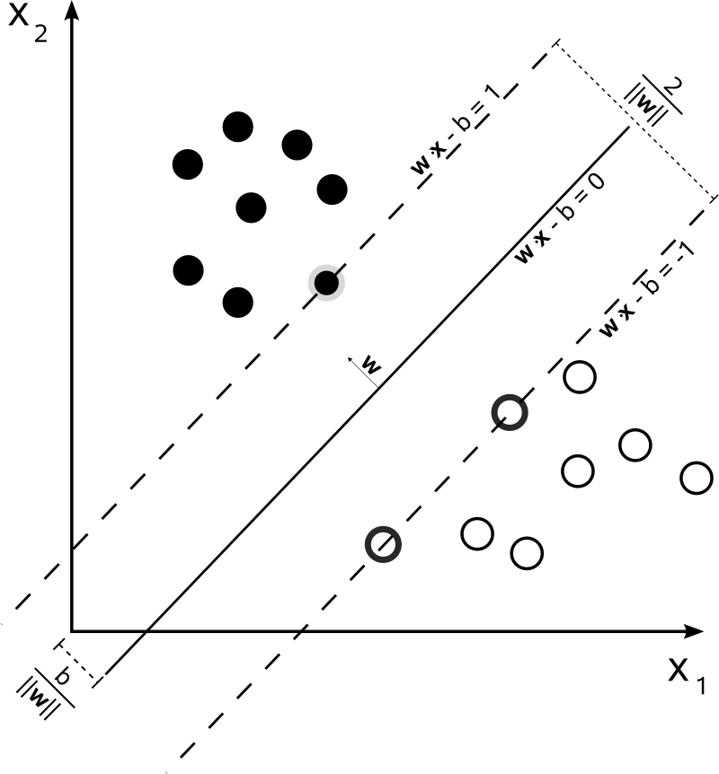
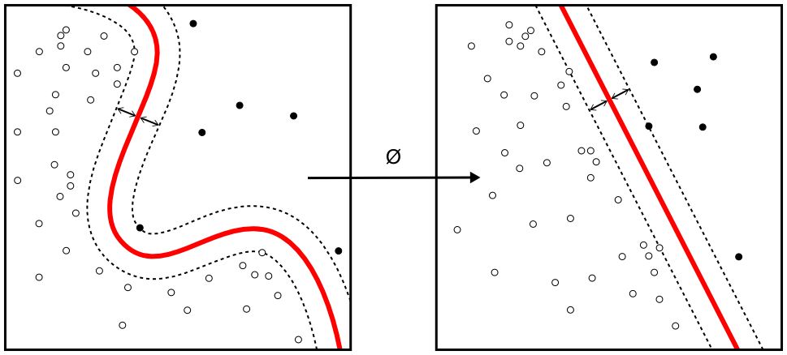

# Wykład 5: Maszyny wektorów nośnych (SVM i SVR) {.unnumbered}

```{r}
#| label: wyk5-utf8
#| include: false
source("R/setup.R")
```

::: hidden
$$
 \def\E{\mathrm{E}}
 \def\Var{\mathrm{Var}}
 \def\P{\mathrm{P}}
$$
:::

## Wprowadzenie

W tym rozdziale przedstawimy model **SVM** (*Support Vector Machine*) w wersji możliwie intuicyjnej. Nie będziemy wyprowadzać pełnego problemu optymalizacyjnego. Skupimy się na tym, co model robi, jak czytać jego najważniejsze parametry i jak zastosować go w R do dwóch typowych zadań:

1.  **klasyfikacji**, czyli przewidywania klasy obserwacji,
2.  **regresji**, czyli przewidywania wartości liczbowej.

SVM można traktować jako metodę, która szuka rozsądnej granicy między obserwacjami. W klasyfikacji ta granica oddziela klasy, a w regresji przyjmuje postać krzywej lub powierzchni, wokół której budujemy pas tolerancji dla błędów.

::: callout-note
### Co będzie wynikiem tej analizy?

Na końcu będziemy umieli wyjaśnić, czym są margines, wektory nośne, parametr `C`, jądro RBF oraz tolerancja `epsilon` w regresji SVR. Zobaczymy też dwa praktyczne przykłady w R: klasyfikację gatunków pingwinów oraz regresję cen domów.
:::

## Formułowanie celu i problemów badawczych

### Cel dydaktyczny

Chcemy zrozumieć SVM jako narzędzie predykcyjne, które może działać zarówno dla zmiennej jakościowej, jak i liczbowej. W klasyfikacji model odpowiada na pytanie: „do której grupy należy obserwacja?”. W regresji odpowiada na pytanie: „jaką wartość liczbową można przewidzieć dla obserwacji?”.

::: callout-important
### Jasne określenie celu

**Cel wykładu:** pokazać model SVM bez nadmiernego formalizmu matematycznego oraz zastosować go w R do klasyfikacji i regresji.
:::

### Problemy badawcze

Interesuje nas odpowiedź na następujące pytania:

1.  Jak SVM wyznacza granicę decyzyjną między klasami?
2.  Czym są margines i wektory nośne?
3.  Dlaczego w SVM konieczne jest skalowanie zmiennych?
4.  Jak działa SVM z jądrem RBF w problemach nieliniowych?
5.  Jak zmienia się intuicja modelu, gdy przechodzimy od klasyfikacji SVM do regresji SVR?
6.  Jak zbudować i ocenić modele SVM w R?

## SVM w klasyfikacji

### Intuicja: najbezpieczniejsza granica

Wyobraźmy sobie dwa zbiory punktów na płaszczyźnie. Punkty jednej klasy są po lewej stronie, a punkty drugiej klasy po prawej. Można narysować wiele prostych, które rozdzielą te klasy. SVM nie wybiera dowolnej poprawnej prostej. Wybiera taką, która zostawia możliwie największy odstęp od najbliższych punktów obu klas.

Ten odstęp nazywamy **marginesem**. Im szerszy margines, tym większy „zapas bezpieczeństwa” decyzji. Jeśli nowa obserwacja jest trochę zaszumiona albo pomiar jest niedokładny, szeroki margines może pomóc modelowi zachować stabilną decyzję.

{fig-align="center" width=45%}

Na ilustracji linia środkowa jest granicą decyzyjną. Linie przerywane wyznaczają brzegi marginesu. Punkty najbliżej tych linii mają największe znaczenie dla modelu. To właśnie one są **wektorami nośnymi**.

### Wektory nośne

Wektory nośne to obserwacje, które „podpierają” granicę decyzyjną. Gdybyśmy usunęli punkty leżące daleko od granicy, model prawdopodobnie prawie by się nie zmienił. Gdybyśmy usunęli jeden z punktów położonych na brzegu marginesu, granica mogłaby przesunąć się wyraźnie.

Z punktu widzenia intuicji oznacza to, że SVM nie korzysta w jednakowym stopniu ze wszystkich obserwacji. Najważniejsze są obserwacje trudne: bliskie granicy, leżące w marginesie albo błędnie sklasyfikowane.

### Twardy i miękki margines

W idealnej sytuacji klasy można rozdzielić bezbłędnie. Wtedy mówimy o **twardym marginesie**. W praktyce dane rzadko są idealne. Klasy częściowo na siebie zachodzą, pojawiają się obserwacje nietypowe, a pomiar może być zaszumiony.

Dlatego częściej stosujemy **miękki margines**. Model nadal próbuje uzyskać szeroki margines, ale dopuszcza pewne naruszenia. Parametr `C` mówi, jak mocno karzemy takie naruszenia:

- małe `C` oznacza większą tolerancję błędów i zwykle gładszą granicę,
- duże `C` oznacza silniejsze dopasowanie do danych treningowych i mniejszą tolerancję błędów.

::: callout-tip
### Prosta interpretacja parametru `C`

Parametr `C` reguluje kompromis: czy wolimy szerszy margines i większą tolerancję trudnych punktów, czy dokładniejsze dopasowanie do danych treningowych.
:::

### Gdy prosta nie wystarcza: jądra

Nie wszystkie dane da się dobrze rozdzielić prostą linią. Czasem klasy tworzą kształty zakrzywione, okręgi, pasma albo bardziej złożone obszary. Wtedy SVM może użyć **jądra** (*kernel*).

Jądro pozwala modelowi działać tak, jakby dane zostały przeniesione do bogatszej przestrzeni cech. W tej nowej przestrzeni prosta granica może odpowiadać zakrzywionej granicy w oryginalnych danych.

{fig-align="center" width=70%}

Ilustracja pokazuje najważniejszą ideę: w oryginalnej przestrzeni granica może być nieliniowa, ale po przekształceniu danych model może potraktować problem jak separację liniową w innej przestrzeni.

Najczęściej stosowane jądro w prostych zastosowaniach tabularycznych to **RBF** (*radial basis function*). Działa ono na zasadzie podobieństwa: dwie obserwacje są do siebie podobne, jeśli leżą blisko siebie po uwzględnieniu wszystkich cech.

### Parametr `sigma` w jądrze RBF

W praktyce jądro RBF ma parametr określający, jak lokalnie model patrzy na dane. W pakiecie `kernlab` i w `tidymodels` często spotykamy nazwę `rbf_sigma`.

- małe `sigma` daje gładszą, bardziej ogólną granicę,
- duże `sigma` daje granicę bardziej lokalną i silniej dopasowaną do danych.

Parametry `C` i `sigma` trzeba zwykle dobrać przez walidację krzyżową. Nie ma jednej wartości dobrej dla wszystkich problemów.

### Dlaczego trzeba skalować zmienne?

SVM jest wrażliwy na skalę zmiennych. Jeżeli jedna cecha jest mierzona w tysiącach, a druga w ułamkach, to odległości między obserwacjami zostaną zdominowane przez cechę o większej skali. Model może wtedy uznać tę zmienną za ważniejszą tylko dlatego, że ma większe jednostki.

Dlatego przed dopasowaniem SVM prawie zawsze wykonujemy standaryzację zmiennych liczbowych. W przykładach zrobimy to automatycznie w `recipe()` za pomocą `step_normalize()`.

## SVM w regresji: SVR

### Intuicja: rurka tolerancji

W regresji nie rozdzielamy klas. Chcemy przewidzieć wartość liczbową, na przykład cenę, czas albo wagę. Wersja regresyjna SVM nazywa się **SVR** (*Support Vector Regression*).

Najważniejsza intuicja SVR jest inna niż w klasycznej regresji liniowej. Model nie próbuje karać każdego, nawet minimalnego błędu. Zamiast tego buduje wokół funkcji predykcyjnej pas tolerancji, nazywany często **rurką epsilon**.

Jeśli obserwacja znajduje się wewnątrz tej rurki, błąd jest uznawany za akceptowalny. Model zaczyna karać dopiero te obserwacje, które wychodzą poza dopuszczalny pas.

```{r}
#| label: wyk5-ilustracja-svr
#| fig-cap: "Intuicja regresji SVR: funkcja predykcyjna i rurka tolerancji epsilon"
library(tidyverse)

set.seed(2026)

epsilon <- 0.45

dane_rurka <- tibble(
  x = seq(0, 10, length.out = 40),
  y_true = sin(x / 1.5) + 0.25 * x,
  y = y_true + rnorm(length(x), sd = 0.45)
)

krzywa <- tibble(
  x = seq(0, 10, length.out = 200),
  y_hat = sin(x / 1.5) + 0.25 * x
)

ggplot() +
  geom_ribbon(
    data = krzywa,
    aes(x = x, ymin = y_hat - epsilon, ymax = y_hat + epsilon),
    fill = "steelblue", alpha = 0.18
  ) +
  geom_line(data = krzywa, aes(x = x, y = y_hat),
            color = "steelblue", linewidth = 1.2) +
  geom_point(data = dane_rurka, aes(x = x, y = y),
             size = 2.2, alpha = 0.8) +
  labs(
    x = "Predyktor",
    y = "Zmienna przewidywana",
    caption = "Niebieski pas pokazuje zakres błędów, które SVR traktuje jako akceptowalne."
  ) +
  theme_minimal(base_size = 13)
```

Ilustracja przedstawia ideę pasa tolerancji wokół zadanej funkcji; nie jest wynikiem dopasowania modelu SVR do tych punktów.

### Parametr `epsilon`

Parametr `epsilon` określa połowę szerokości rurki tolerancji (pełna szerokość to $2\epsilon$):

- małe `epsilon` oznacza, że model reaguje nawet na małe błędy,
- duże `epsilon` oznacza, że model ignoruje większe odchylenia.

W regresji SVR nadal występuje parametr `C`. Jego interpretacja jest podobna jak w klasyfikacji: mówi, jak silnie karzemy obserwacje wychodzące poza tolerancję.

::: callout-note
### Klasyfikacja a regresja

W klasyfikacji SVM szuka granicy między klasami. W regresji SVR szuka funkcji predykcyjnej i buduje wokół niej pas tolerancji. W obu przypadkach szczególnie ważne są obserwacje trudne: bliskie granicy albo leżące poza tolerancją.
:::

## Przykład 1: klasyfikacja gatunków pingwinów

### Cel przykładu

W pierwszym przykładzie użyjemy zbioru `penguins` z pakietu `palmerpenguins`. Celem jest przewidywanie gatunku pingwina na podstawie cech morfologicznych.

Jest to problem klasyfikacji wieloklasowej, ponieważ zmienna `species` przyjmuje trzy wartości. Implementacje SVM rozwiązują taki problem przez złożenie wielu klasyfikatorów binarnych.

### Przygotowanie danych

```{r}
#| label: wyk5-klasyfikacja-przygotowanie
library(tidymodels)
library(palmerpenguins)
library(gt)

set.seed(2026)

dane_klasyfikacja <- penguins |>
  select(species, bill_length_mm, bill_depth_mm,
         flipper_length_mm, body_mass_g) |>
  drop_na() |>
  mutate(species = factor(species))

dane_klasyfikacja |>
  head() |>
  gt() |>
  formatuj_tabele() |>
  tab_caption("Przykładowe obserwacje w zbiorze penguins")
```

Wykorzystujemy cztery cechy liczbowe opisujące budowę ciała pingwina, mierzone w różnych jednostkach (stąd standaryzacja w recepcie). Ustawienie `scaled = FALSE` wyłącza dodatkowe skalowanie przez `kernlab`, ponieważ przetwarzanie predyktorów wykonuje recepta.

```{r}
#| label: wyk5-klasyfikacja-eda
#| fig-cap: "Dwie cechy morfologiczne pingwinów według gatunku"
ggplot(dane_klasyfikacja,
       aes(x = bill_length_mm, y = bill_depth_mm, color = species)) +
  geom_point(size = 2, alpha = 0.8) +
  labs(
    x = "Długość dzioba [mm]",
    y = "Głębokość dzioba [mm]",
    color = "Gatunek"
  ) +
  theme_minimal(base_size = 13)
```

Na wykresie widać, że gatunki częściowo tworzą odrębne obszary, ale nie są rozdzielone idealnie. To dobra sytuacja do pokazania SVM: model musi znaleźć granice między klasami, lecz powinien unikać zbyt dosłownego dopasowania do pojedynczych punktów.

### Podział danych i recepta

```{r}
#| label: wyk5-klasyfikacja-podzial
split_klasyfikacja <- initial_split(
  dane_klasyfikacja,
  prop = 0.8,
  strata = species
)

train_klasyfikacja <- training(split_klasyfikacja)
test_klasyfikacja <- testing(split_klasyfikacja)

foldy_klasyfikacja <- vfold_cv(
  train_klasyfikacja,
  v = 5,
  strata = species
)
```

```{r}
#| label: wyk5-klasyfikacja-recipe
recepta_klasyfikacja <- recipe(species ~ ., data = train_klasyfikacja) |>
  step_normalize(all_numeric_predictors())
```

### Model SVM z jądrem RBF

```{r}
#| label: wyk5-klasyfikacja-model
model_svm_klasyfikacja <- svm_rbf(
  cost = tune(),
  rbf_sigma = tune()
) |>
  set_engine("kernlab", scaled = FALSE) |>
  set_mode("classification")

workflow_klasyfikacja <- workflow() |>
  add_recipe(recepta_klasyfikacja) |>
  add_model(model_svm_klasyfikacja)

siatka_klasyfikacja <- crossing(
  cost = c(0.25, 1, 4, 16),
  rbf_sigma = c(0.01, 0.05, 0.10, 0.20)
)
```

W siatce parametrów porównujemy różne wartości `cost` i `rbf_sigma`. Nie zgadujemy ich ręcznie. Sprawdzamy, które ustawienia działają najlepiej w walidacji krzyżowej.

```{r}
#| label: wyk5-klasyfikacja-strojenie
metryki_klasyfikacja <- metric_set(accuracy, kap)

wyniki_klasyfikacja <- tune_grid(
  workflow_klasyfikacja,
  resamples = foldy_klasyfikacja,
  grid = siatka_klasyfikacja,
  metrics = metryki_klasyfikacja
)

show_best(wyniki_klasyfikacja, metric = "accuracy", n = 8) |>
  select(-any_of(c(".metric", ".estimator", ".config"))) |>
  tabela_wynikow("Najlepsze ustawienia — klasyfikacja")
```

### Ocena modelu na zbiorze testowym

```{r}
#| label: wyk5-klasyfikacja-final
najlepsze_klasyfikacja <- select_best(
  wyniki_klasyfikacja,
  metric = "accuracy"
)

finalny_workflow_klasyfikacja <- finalize_workflow(
  workflow_klasyfikacja,
  najlepsze_klasyfikacja
)

fit_klasyfikacja <- last_fit(
  finalny_workflow_klasyfikacja,
  split_klasyfikacja,
  metrics = metryki_klasyfikacja
)

collect_metrics(fit_klasyfikacja) |>
  select(.metric, .estimate) |>
  rename(Metryka = .metric, Wartosc = .estimate) |>
  tabela_wynikow("Wyniki na zbiorze testowym") |>
  cols_label(Wartosc = "Wartość")
```

```{r}
#| label: wyk5-klasyfikacja-macierz
predykcje_klasyfikacja <- collect_predictions(fit_klasyfikacja)

macierz <- predykcje_klasyfikacja |>
  conf_mat(truth = species, estimate = .pred_class)
tabela_pomylek_gt(t(macierz$table), "Macierz pomyłek — gatunki pingwinów")
```

Wynik testowy dotyczy tego podziału, nie gwarantuje trafności w innych koloniach. Do oceny przenoszenia modelu na inne kolonie lub lata potrzebna jest walidacja według miejsca lub czasu.

Macierz pomyłek pokazuje, które gatunki są mylone najczęściej. Jeżeli większość wartości leży na przekątnej, oznacza to, że model dobrze rozpoznaje gatunki. Pomyłki poza przekątną warto interpretować biologicznie: gatunki o podobnych cechach morfologicznych mogą być trudniejsze do rozróżnienia.

## Przykład 2: regresja ceny domu

### Cel przykładu

W drugim przykładzie zastosujemy regresję SVR do danych `ames` z pakietu `modeldata`. Celem będzie przewidywanie ceny sprzedaży domu na podstawie kilku cech opisujących nieruchomość.

To inny typ problemu niż klasyfikacja pingwinów. Tutaj wynik nie jest klasą, lecz liczbą.

### Przygotowanie danych

```{r}
#| label: wyk5-regresja-przygotowanie
dane_regresja <- modeldata::ames |>
  select(
    Sale_Price, Neighborhood, Gr_Liv_Area, Year_Built,
    Year_Remod_Add, Total_Bsmt_SF, Garage_Area, Garage_Cars,
    Full_Bath, Overall_Cond, Lot_Area
  ) |>
  mutate(
    log_cena = log10(Sale_Price),
    cena_tys = Sale_Price / 1000
  )

dane_regresja |>
  select(Sale_Price, log_cena, Neighborhood, Gr_Liv_Area,
         Garage_Area, Year_Built) |>
  head() |>
  gt() |>
  formatuj_tabele() |>
  tab_caption("Przykładowe obserwacje w zbiorze ames")
```

W modelowaniu będziemy przewidywać `log_cena`, czyli logarytm dziesiętny ceny. Ceny nieruchomości mają zwykle rozkład prawostronnie skośny: większość domów ma ceny umiarkowane, a niewielka grupa jest bardzo droga. Logarytm ceny zwykle daje stabilniejszy problem regresyjny.

```{r}
#| label: wyk5-regresja-eda
#| fig-cap: "Cena sprzedaży a powierzchnia mieszkalna"
ggplot(dane_regresja, aes(x = Gr_Liv_Area, y = cena_tys)) +
  geom_point(size = 2, alpha = 0.8) +
  geom_smooth(method = "loess", se = FALSE, color = "darkorange") +
  labs(
    x = "Powierzchnia mieszkalna nad poziomem gruntu\n[stopy kwadratowe]",
    y = "Cena sprzedaży [tys. dolarów]"
  ) +
  theme_minimal(base_size = 13)
```

Zależność między powierzchnią mieszkalną a ceną jest wyraźna, ale nie wyjaśnia wszystkiego. Na cenę wpływają także rok budowy, garaż, powierzchnia piwnicy, stan techniczny i lokalizacja. Model z jądrem RBF może uchwycić nieliniowe zależności między tymi cechami.

### Podział danych i recepta

```{r}
#| label: wyk5-regresja-podzial
set.seed(2026)

split_regresja <- initial_split(
  dane_regresja,
  prop = 0.8,
  strata = log_cena
)

train_regresja <- training(split_regresja)
test_regresja <- testing(split_regresja)

foldy_regresja <- vfold_cv(
  train_regresja,
  v = 3,
  strata = log_cena
)
```

```{r}
#| label: wyk5-regresja-recipe
recepta_regresja <- recipe(
  log_cena ~ Neighborhood + Gr_Liv_Area + Year_Built +
    Year_Remod_Add + Total_Bsmt_SF + Garage_Area + Garage_Cars +
    Full_Bath + Overall_Cond + Lot_Area,
  data = train_regresja
) |>
  step_other(all_nominal_predictors(), threshold = 0.01) |>
  step_dummy(all_nominal_predictors()) |>
  step_zv(all_predictors()) |>
  step_normalize(all_numeric_predictors())
```

### Model SVR z jądrem RBF

```{r}
#| label: wyk5-regresja-model
model_svr <- svm_rbf(
  cost = tune(),
  rbf_sigma = tune(),
  margin = tune()
) |>
  set_engine("kernlab", scaled = FALSE) |>
  set_mode("regression")

workflow_regresja <- workflow() |>
  add_recipe(recepta_regresja) |>
  add_model(model_svr)

siatka_regresja <- crossing(
  cost = c(1, 5, 20),
  rbf_sigma = c(0.005, 0.02, 0.08),
  margin = c(0.01, 0.03, 0.06)
)
```

W regresji stroimy trzy parametry:

- `cost`, czyli siłę kary za obserwacje źle dopasowane,
- `rbf_sigma`, czyli lokalność jądra RBF,
- `margin`, czyli `epsilon` — połowę szerokości pasa tolerancji.

W silniku jawnie ustawiamy `scaled = FALSE`: predyktory standaryzuje recepta, a cel pozostaje na skali `log10(ceny)`. Dzięki temu `margin` ma jednostki logarytmu ceny. Domyślne skalowanie w `kernlab` obejmowałoby również zmienną docelową, zmieniając interpretację tej wartości.

```{r}
#| label: wyk5-regresja-strojenie
metryki_regresja <- metric_set(yardstick::rmse, yardstick::mae, yardstick::rsq)

wyniki_regresja <- tune_grid(
  workflow_regresja,
  resamples = foldy_regresja,
  grid = siatka_regresja,
  metrics = metryki_regresja
)

show_best(wyniki_regresja, metric = "rmse", n = 8) |>
  select(-any_of(c(".metric", ".estimator", ".config"))) |>
  tabela_wynikow("Najlepsze ustawienia — regresja")
```

### Ocena modelu na zbiorze testowym

```{r}
#| label: wyk5-regresja-final
najlepsze_regresja <- select_best(
  wyniki_regresja,
  metric = "rmse"
)

finalny_workflow_regresja <- finalize_workflow(
  workflow_regresja,
  najlepsze_regresja
)

fit_regresja <- last_fit(
  finalny_workflow_regresja,
  split_regresja,
  metrics = metryki_regresja
)

collect_metrics(fit_regresja) |>
  select(.metric, .estimate) |>
  rename(Metryka = .metric, Wartosc = .estimate) |>
  tabela_wynikow("Wyniki na zbiorze testowym") |>
  cols_label(Wartosc = "Wartość")
```

Eksponentowanie prognozy logarytmu nie daje automatycznie średniej ceny w dolarach (nierówność Jensena). Jest to prognoza na przekształconej skali, a pas $\epsilon$ nie jest przedziałem predykcyjnym o zadanym pokryciu. Używane `yardstick::rsq()` jest kwadratem korelacji, nie $1-\mathrm{SSE}/\mathrm{SST}$; porównujmy też RMSE i MAE.

```{r}
#| label: wyk5-regresja-predykcje
predykcje_regresja <- collect_predictions(fit_regresja)

predykcje_regresja |>
  mutate(
    cena_rzeczywista = 10^log_cena,
    cena_przewidywana = 10^.pred,
    blad = cena_przewidywana - cena_rzeczywista,
    blad_proc = 100 * blad / cena_rzeczywista
  ) |>
  select(cena_rzeczywista, cena_przewidywana, blad, blad_proc) |>
  slice_head(n = 10) |>
  gt() |>
  formatuj_tabele() |>
  fmt_currency(columns = c(cena_rzeczywista, cena_przewidywana, blad),
               currency = "USD", decimals = 3) |>
  fmt_number(columns = blad_proc, decimals = 3) |>
  tab_caption("Przykładowe predykcje SVR dla cen domów")
```

```{r}
#| label: wyk5-regresja-wykres
#| fig-cap: "Wartości rzeczywiste i przewidywane w regresji SVR"
predykcje_regresja |>
  mutate(
    cena_rzeczywista = 10^log_cena,
    cena_przewidywana = 10^.pred
  ) |>
  ggplot(aes(x = cena_rzeczywista, y = cena_przewidywana)) +
  geom_point(color = "steelblue", size = 2, alpha = 0.75) +
  geom_abline(slope = 1, intercept = 0, color = "darkorange", linewidth = 1) +
  scale_x_continuous(labels = scales::label_dollar()) +
  scale_y_continuous(labels = scales::label_dollar()) +
  labs(
    x = "Cena rzeczywista",
    y = "Cena przewidywana"
  ) +
  theme_minimal(base_size = 13)
```

Punkty blisko przekątnej oznaczają trafne predykcje. Punkty powyżej przekątnej oznaczają przeszacowanie ceny, a punkty poniżej przekątnej oznaczają niedoszacowanie.

## Najważniejsze zalety i ograniczenia SVM

### Zalety

SVM dobrze działa w wielu problemach o umiarkowanej liczbie obserwacji i kilku lub kilkunastu sensownych predyktorach. Dzięki jądrom może modelować nieliniowe granice decyzyjne bez ręcznego tworzenia złożonych transformacji zmiennych. Dobrze nadaje się także do danych, w których istotna jest geometria podobieństwa między obserwacjami.

### Ograniczenia

SVM wymaga skalowania zmiennych, a wyniki mogą silnie zależeć od doboru parametrów. Modele z jądrami bywają mniej interpretowalne niż regresja liniowa czy pojedyncze drzewo decyzyjne. Dla bardzo dużych zbiorów danych klasyczny kernelowy SVM może być kosztowny obliczeniowo.

::: callout-warning
### Typowy błąd praktyczny

Nie należy dopasowywać SVM do nieskalowanych danych liczbowych i od razu interpretować słabego wyniku jako wady metody. Dla SVM standaryzacja predyktorów jest częścią procedury, a nie kosmetycznym dodatkiem.
:::

## Wnioski

SVM jest modelem opartym na geometrii danych. W klasyfikacji szuka granicy, która oddziela klasy z możliwie szerokim marginesem. Najważniejsze dla położenia tej granicy są wektory nośne, czyli obserwacje położone najbliżej granicy lub naruszające margines.

W praktyce najważniejsze są trzy decyzje: skalowanie zmiennych, wybór jądra oraz dobór parametrów przez walidację krzyżową. W przykładach zastosowaliśmy jądro RBF, ponieważ jest elastyczne i dobrze nadaje się do pokazania nieliniowych zależności.
